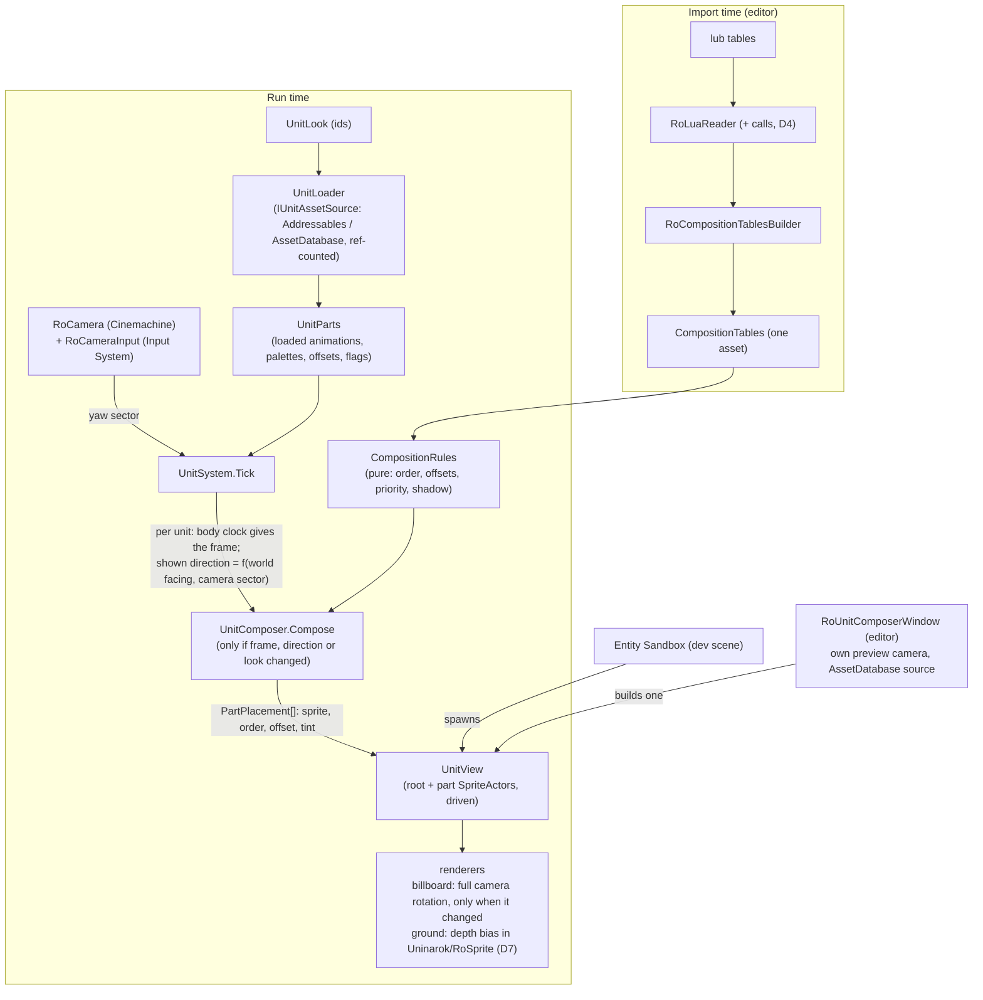

# PLAN-0009: Unit Display and Camera

| | |
|---|---|
| **Implements** | [spec.md](spec.md) (SPEC-0009, approved 2026-11-21; revisions of 2026-11-23 approved 2026-11-23: FR-1 and FR-15 amended, FR-17 and FR-18 added) |
| **Status** | Implementing (revision 2026-11-23, approved by the owner 2026-11-23: §4.11 both hands, §4.12 composer presets, D31 to D40, R12 to R17, the notes marked "Revision 2026-11-23"); the rest Implemented (2026-11-22; approved by the owner 2026-11-21; §4.10, FR-16, approved 2026-11-22) |
| **Audience** | Architects, senior developers, AI agents |

> This file defines **how**. Requirement IDs (`FR-n`) refer to `spec.md`. One sprite (sheets, animations, palettes, `SpriteActor`, `SpriteSystem`, `Uninarok/RoSprite`) is [PLAN-0007](../0007-spr-act-pal-sprites/plan.md); finding sprites by id (`SpriteCatalog`, entries, the lub reader) is [PLAN-0008](../0008-sprite-catalog/plan.md); map scenes and `MapData` are PLAN-0005/0006. This plan adds the layer above them: **a look (ids) → loaded parts → one composed, camera-facing unit**, plus the camera that looks at it. The composition rules taken from the client's tables are documented in [composition-reference.md](composition-reference.md) (written in T0.2, normative for its topic, updated in the same commit as the code that uses it).

## 1. Constraints and assumptions

- **One new package, no third-party library.** `com.unity.cinemachine` (3.x, owner decision 2026-11-21; the exact version is the newest registry version that resolves and compiles with no warnings on Unity 6000.7.0b7, checked in T0.1, as PLAN-0008 did for Addressables) drives the camera (§4.7, D8). **T0.1 result (2026-11-22):** 6.7.0, the only version the registry offers for this editor: the Cinemachine 3 API under the editor's version number (`CinemachineCamera`, `CinemachineOrbitalFollow`, namespace `Unity.Cinemachine`); compiles with no warnings (D14). Input uses `com.unity.inputsystem` 6.7.0 (already in the manifest); rendering stays URP sprites with `Uninarok/RoSprite`.
- **The runtime never reads lub files.** The client's composition tables (draw order, offsets, riding corrections, headgear priorities, shadow scales) are read at import time through the PLAN-0008 reader and written to one asset (§4.1). The game reads only that asset and the catalog.
- **Spec wording to align (owner):** spec §6 says "this spec adds no new import". The composition tables must come from somewhere at run time, so this plan adds one small table import (one asset, seconds to run, D1). No sprite is imported. The intended reading is "no new sprite import"; the owner confirms before the spec is approved.
- **Pure rules, thin components.** Facing, draw order, attachment and clocks are plain C# (`Uninarok.Units` core, no `MonoBehaviour`) and tested in EditMode with synthetic data. Components only copy results to renderers.
- **One update loop for all units**, like `SpriteSystem` (PLAN-0007 D4): no `Update` per unit or per part.
- **Facts used** (sprite-catalog.md §1, read 2026-11-21 with a bytecode dump, to be confirmed in T0.2): `tb_layer_priority.lub` gives a draw priority per headgear view id (`Default_Mid 100`, `Default_Top 200`, `Default_Bottom 300`, `Default_Robe 400`, per item `Default`, optional per `Direction`, `isIgnoreRiding`); `spreditinfo/*layerdir_*.lub` give, per job and file action index, lists of frame numbers (the frames where a layer swaps); `_2dlayer_headtobody.lub` holds rows of 5 numbers (sex, job, action, …); `ridingspreditinfo.lub` is a list of calls `SetHeadSprEditInfo(job, firstAction, lastAction, …, dx, dy)` and `SetBodySprEditInfo(...)`; `offsetitempos.lub` is calls `OffsetItemPos.AddOffset…(viewId, direction, {x, y})` with a Doram variant; `transparentitem.lub` rows of (view id, r, g, alpha); `spriterobename.lub` holds `RobeTopLayer`; `shadowtable.lub` gives 987 job ids a shadow scale (`ReqshadowFactor` returns −1 for an id not listed, which means the default 1). The exact meaning of every column is T0.2's job; the plan fixes the shape of the data, not the client's numbers.
- **Directions.** The world facing is `UninarokDirection`. The sprite's action direction is the shown direction (§4.3). The offset between network direction 0 and the sprite's front (action direction 0 faces the viewer, PLAN-0007 preview) is checked in T0.3 against a real capture and the original client, and recorded in `UninarokPosition.md` (R1).
- **Decided by the owner (spec §7):** body's clock drives every part (OQ-4); sectors of 45° with borders at ±22.5° (OQ-2); perspective camera at 15° (OQ-6); roBrowser controls, client values measured side by side (OQ-1); budget 100 players + 200 monsters ≤ 2 ms (OQ-3); doram and mounts in the reference set (OQ-5).
- Scale: one ground cube = 1 Unity unit (SPEC-0002 FR-7); a cell is 0.5 u; one Ragnarok world unit is 0.1 u. Sprite pixels use the animation's `PixelsPerUnit` (PLAN-0007).
- **Revision 2026-11-23 (FR-1, FR-15, FR-17, FR-18).** Implemented sections are not rewritten: the revision is in the new §4.11 (both hands) and §4.12 (composer presets), in notes marked "Revision 2026-11-23" in the sections they change, and in D31 to D40. Facts it rests on: Hercules sends the right hand as the weapon view and the left as the shield view, each the item's `View` if its item_db row has one, else the item id (`clif_get_weapon_view`; Knife 1201, Javelin 1401 and Rod 1601 have no `View` in `db/pre-re/item_db.conf`, so they arrive as item ids). The catalog already imports the assassin's two-weapon sprites (`어세신_남_단검_단검`, `_검_검`, `_도끼_도끼`, `_단검_검`, … in the catalog ledger), one weapon entry per view id 25 to 30 (`WeaponNameTable`, sprite-catalog §3.8). The weapon-type rule that combat (SPEC-0011 FR-15) and display (FR-17) share is defined once, in `Uninarok.Units` (§4.11, D31), the lowest assembly both reach. PLAN-0011's revision makes combat call it; this plan does not change combat's motion choice.

## 2. Architecture

Satisfies FR-1 to FR-15; revision 2026-11-23: FR-17 (both hands resolved by `WeaponHands` before `UnitLoader` picks the weapon and shield sprites, §4.11) and FR-18 (composer presets, editor only, §4.12). The diagram is unchanged: both live inside the `UnitLoader` and `RoUnitComposerWindow` boxes.



Data flow per frame: `UnitSystem.Tick(dt)` reads the camera once (yaw sector, rotation changed?), then for each unit advances the body clock, derives frame and shown direction, recomposes only when one of them, the look, or the head facing changed, and writes part renderers through the existing `SpriteActor` (driven mode, §4.4). No allocation.

## 3. Assemblies and file layout

Satisfies FR-13, FR-15 (placement), and the dev-only rule.

| Assembly | Path | References | Contents |
|---|---|---|---|
| `Uninarok.Units` (new) | `Assets/Scripts/Units/` | `Uninarok.Sprites`, `Uninarok.SpriteCatalog`, `Uninarok.Networking` (data enums), `Uninarok.Map`, Addressables | `UnitLook`, `CompositionTables`, `CompositionRules`, `UnitComposer`, `UnitFacing`, `UnitClock`, `UnitLoader`, `IUnitAssetSource`, `AddressablesUnitAssetSource`, `UnitView`, `UnitSystem`, `UnitShadow` |
| `Uninarok.CameraRig` (new) | `Assets/Scripts/CameraRig/` | `Unity.Cinemachine`, `Unity.InputSystem` | `RoCamera`, `RoCameraSettings` (asset), `RoCameraInput`, `RoCameraRig.prefab` |
| `Uninarok.Units.Dev` (new) | `Assets/Scripts/Units/Dev/` | Units, CameraRig, Map | `EntitySandbox`, `EntitySandboxStress`, `EntitySandboxPanel` (IMGUI). Every file wrapped in `#if UNITY_EDITOR \|\| DEVELOPMENT_BUILD`, as SPEC-0001's dev code (D11) |
| `Uninarok.Units.Editor` (new, editor only) | `Assets/Scripts/Units/Editor/` | Units, CameraRig, SpriteCatalog, `Uninarok.RoImport.Editor` (catalog paths, `RoCatalogLookupWindow.LoadInEditor`) | `RoUnitComposerWindow`, `AssetDatabaseUnitAssetSource`, `UnitPreviewStage` |
| `Uninarok.RoImport.Core` / `.Editor` (changed) | `Assets/Editor/RoImport/…/Catalog/` | — | `RoLuaReader` call capture (D4), `RoCompositionTablesBuilder` (Core, pure), `RoCompositionTablesConverter` and a **Composition** entry in the catalog import menu (Editor) |
| `Uninarok.Sprites` (changed) | `Assets/Scripts/Sprites/` | — | `SpriteActor` driven mode (§4.4), `Uninarok/RoSprite` depth bias (D7) |
| Tests | `Assets/Tests/EditMode/Units/`, `Assets/Tests/EditMode/CameraRig/`, `Assets/Tests/EditMode/RoImport/Catalog/Composition/`, `Assets/Tests/PlayMode/Units/` | — | §6 |

Data and scenes:

- `Assets/Art/Imported/catalog/composition.asset` (`CompositionTables`, Addressables key `catalog/composition`, written by the import; generated: never hand-edited).
- `Assets/Settings/Units/RoCameraSettings.asset` (defaults and limits, filled from the T6.4 measurement).
- `Assets/Scenes/Dev/EntitySandbox.unity` (new; loads `Scenes/Maps/prontera.unity` additively). Not in the build scene list; release builds never contain it (D11).
- `docs/specs/0009-unit-display/composition-reference.md` (T0.2).

**Revision 2026-11-23** (FR-17, FR-18): new and changed files.

| Assembly | Path | Change |
|---|---|---|
| `Uninarok.Units` | `Assets/Scripts/Units/Rules/WeaponHands.cs` (new) | `HandKind`, `Hand`, `WeaponSource`, `HandsResult`, `WeaponHands`: the shared two-hands rule (§4.11) |
| `Uninarok.Units` | `Assets/Scripts/Units/Rules/JobFamilies.cs` (new) | `JobFamilies.IsAssassinFamily` (§4.11; PLAN-0011's revision may add the other families to the same class) |
| `Uninarok.Units` | `Assets/Scripts/Units/Loading/UnitLoader.cs`, `UnitLook.cs`, `UnitParts.cs` (changed) | hands resolved through `WeaponHands`; `UnitLook.RightValue`/`LeftValue`; `LoadReport.Hands` |
| `Uninarok.World` | `Assets/Scripts/World/View/Combat/CatalogWeaponTypes.cs`, `Assets/Scripts/World/View/EntityLookMapping.cs` (changed) | delegate to `WeaponHands` (same behaviour); `CatalogWeaponTypes.HandsOf` |
| `Uninarok.Units.Editor` | `Assets/Scripts/Units/Editor/RoUnitComposerWindow.cs` (changed), `UnitComposerPreset.cs`, `UnitComposerPresetStore.cs` (new) | right and left hand inputs, hands line, presets (§4.12) |
| `Uninarok.Units.Editor` | `Assets/Scripts/Units/Editor/Presets/UnitComposerStarterPresets.json` (new, committed) | the four starter presets; inside an `Editor` folder, so never in a build |
| — | `Uninarok-client/UserSettings/Uninarok/UnitComposerPresets.json` (per user, not committed: `UserSettings/` is in `.gitignore`) | user presets |
| Tests | `Assets/Tests/EditMode/Units/WeaponHandsTests.cs`, `UnitLoaderHandsTests.cs`, `UnitComposerPresetStoreTests.cs`; `Assets/Tests/EditMode/World/Combat/CatalogWeaponTypesTests.cs` (extended) | §6 |

## 4. Component contracts

### 4.1 Composition tables: `CompositionTables`, `RoCompositionTablesBuilder`

Satisfies FR-3, FR-4, FR-8, FR-11.

```csharp
namespace Uninarok.Units
{
    public sealed class CompositionTables : ScriptableObject   // written by the import, read-only at run time
    {
        // Headgear draw priority (tb_layer_priority): per view id a default and optional per-direction values.
        public int DefaultTop = 200, DefaultMid = 100, DefaultBottom = 300, DefaultRobe = 400;
        public HeadgearPriority[] Priorities;        // sorted by ViewId
        public int[] RobeTopLayer;                   // garment view ids drawn above the body, sorted
        public LayerSwapList[] LayerSwaps;           // sorted by (Sex, Size, Job, FileAction)
        public HeadToBodyRow[] HeadToBody;           // _2dlayer_headtobody rows, sorted
        public SprEdit[] HeadEdits, BodyEdits;       // riding / body corrections: (Job, FirstAction, LastAction, Dx, Dy, …)
        public ItemOffset[] ItemOffsets;             // (ViewId, Direction, Race, Dx, Dy)
        public ItemTint[] Transparency;              // (ViewId, Colour32)
        public int[] ShadowJobIds; public float[] ShadowScales;   // parallel, sorted; missing id = 1 (FR-11)

        public float ShadowScaleOf(int jobId);       // binary search, default 1
        public int PriorityOf(int viewId, int shownDirection, bool riding, int defaultForSlot);
        public bool TryGetItemOffset(int viewId, int shownDirection, SpriteRace race, out Vector2Int offset);
        // … one TryGet per table; all O(log n) or O(1), no allocation (D5).
    }
}
```

- The struct fields mirror the table columns T0.2 confirms; the plan fixes that **every table is flat, sorted arrays with binary search** (D5).
- `RoCompositionTablesBuilder.Build(RoCatalogTables, IReadOnlyList<RoLuaChunk>) → (CompositionTablesData, gaps)` is pure (plain data in Core); `RoCompositionTablesConverter` writes the asset through the PLAN-0002 writer and ledger, so re-import is stable (unchanged input = "skipped").
- A table whose file is missing or unreadable gives one warning and an empty table; the unit then uses the default rule of §4.5 (FR-1 rule "missing part → warning, rest shows" applied to rules).
- **Import menu:** `Tools/Ragnarok/Import Catalog…` gets one more category, **Composition**, that also runs when Bodies or any equipment category runs (it is seconds; D1).

### 4.2 Look and loading: `UnitLook`, `UnitLoader`, `IUnitAssetSource`

Satisfies FR-1, FR-2, FR-9.

```csharp
public enum UnitKind : byte { Player, Unit }      // Unit = monster / NPC / homunculus / mercenary by job id

[Serializable] public struct UnitLook : IEquatable<UnitLook>
{
    public UnitKind Kind; public int JobId;        // PlayerJob value for players
    public AccountSex Sex; public int BodyStyle;   // costume style → BodyVariantKind
    public int HairStyle, HairColour, ClothColour;
    public int HeadTop, HeadMid, HeadBottom, Garment;      // view ids, 0 = none
    public int Weapon, Shield;                             // view ids (0 = none)
    public int WeaponItem, ShieldItem;                     // item ids, optional, for files named by item (PLAN-0008 D10)
    public static UnitLook ForJob(int jobId);
}

public interface IUnitAssetSource      // where loaded assets come from
{
    SpriteCatalog Catalog { get; }
    CompositionTables Tables { get; }
    void Acquire<T>(AssetReference reference, Action<T> done) where T : Object;   // shared, ref-counted
    void Release(AssetReference reference);
}

public sealed class UnitLoader
{
    public UnitLoader(IUnitAssetSource source);
    // Resolves every part of the look through the catalog, acquires what is not held, then calls done once with the
    // parts. A newer Load for the same view supersedes an older one still in flight (only the newest is applied).
    public void Load(in UnitLook look, UnitParts into, Action<UnitParts, LoadReport> done);
    public void Release(UnitParts parts);
}
```

- **Resolution order** (catalog, PLAN-0008): body `TryFindBody(job)` → `TryGetVariant(job, sex)` (mount by job id, costume by `BodyStyle`); head `TryFindHead(style)` → `TryGetVariant(sex, race)`; equipment `TryFindEquipment(kind, viewId, itemId)` → `TryResolve(job, sex, classes)` (+ trail for weapons); palettes `PaletteSet.TryGet(colour)`; units `TryGetUnit(jobId)`, scale from the record.
- **Classes without a body** (FR-1, D24): when the catalog has no body for the job, every part is looked up as the job it inherits from (`CompositionTables.TryGetBaseJob`); a baby class gets the display scale `UnitLook.BabyScale` (0.8).
- **Player-class job id on an NPC** (FR-2): `UnitLook.ForJob` with a job id below the unit ranges (PLAN-0008 §3.1) gives `Kind = Player` with default look (hair 0…), so such NPCs show as players.
- **Shown as nothing** (FR-2): a job id whose record is empty, or that `CompositionTables` / T0.2 marks as hidden (warp NPC 45, hidden NPCs 111/139 and the `JT_HIDDEN_*` ids), gives a unit with no parts and no shadow; this is not a warning.
- `LoadReport` lists per part: found (and how: "view id 2220 → `_고글`, any-class human male") or missing (and why). The composer window shows it (FR-15); the game logs one `LogWarning` per missing part (FR-1).
- **Sharing** (FR-14): `AddressablesUnitAssetSource` keeps one handle per `RuntimeKey` with a count, so 300 units share each animation and palette once. `AssetDatabaseUnitAssetSource` (editor) loads synchronously and counts the same way.
- **Live change** (FR-9): `UnitView.SetLook(newLook)` diffs old and new per part; only changed parts are acquired; the old asset of a part is released after the new one is applied. The unit's clock, animation and position do not change.
- **Revision 2026-11-23 (FR-1, FR-17).** `Weapon`/`WeaponItem` are the **right hand** and `Shield`/`ShieldItem` the **left hand** as the server sends them (field names kept, D34). The two `Equipment(PartSlot.Weapon…)` / `Equipment(PartSlot.Shield…)` calls of `UnitLoader.Player()` are replaced by the hand resolution of §4.11; a left item that is a weapon is no longer "missing: is a Weapon". Everything else in this section stands.

### 4.3 Facing: `UnitFacing`

Satisfies FR-6, FR-8.

```csharp
public static class UnitFacing
{
    public const int Directions = 8;
    // Camera turn (degrees, any value) → sector 0..7, borders at ±22.5° (OQ-2): floor((yaw + 22.5) / 45) mod 8.
    public static int CameraSector(float yawDegrees);
    // World facing + camera sector → the sprite's action direction (0 = faces the viewer):
    // (FrontOffset - world - sector) mod 8, FrontOffset = 4 (T0.3, D15).
    public const int FrontOffset = 4;
    public static int Shown(UninarokDirection world, int cameraSector);
}
```

- Pure functions; `UnitSystem` computes the camera sector **once per tick** and every unit uses the same value, so all units and all parts of a unit switch sector on the same frame (FR-6).
- The sign (turning the camera right decreases the shown direction) and `FrontOffset = 4` come from T0.3 ([UninarokPosition](../../data/UninarokPosition.md)) and are covered by the FR-6 tests at 0°, 22°, 23°, 90°, 180°.
- **Body and head turning** (FR-6, FR-8). In RO a player turns the body (world facing, 8 directions) and the head separately (straight, left, right of the body), with shift + click on the map, or with commands such as `/doridori` (head left–right repeatedly) and `/bangbang` (body turning round). The server sends both as one direction change (body direction + head direction). This spec only **shows** them: `UnitView.Facing` (body) and `UnitView.HeadFacing` (head) can change at any time, every frame if needed, and the next tick shows them; issuing them from input or chat commands is the world spec's job.
  - `HeadFacing { Straight, Right, Left }`. In `Idle` and `Sit` the player actions are not time-animated: the body and head actions have 3 frames, one per head facing, and the frame shown **is** the head facing (candidate from roBrowser, confirmed in T0.2 against the reference viewer, R3). So the head turn is a frame choice, not an animation, and both body and head use it (the body's frame shows the slight shoulder turn). `UnitClock` holds the frame at `(int)headFacing` for those two animations instead of advancing (D9). Headgears follow the head's frame.
  - In every other animation (walk, attack, …) the head looks straight, as in the client; the head facing is kept and shows again on return to idle or sit.
  - A body turn keeps the current frame in every part (FR-5); a head turn changes only the frame of head and headgears in idle/sit, and the body's 3-frame pose with it.

### 4.4 Parts and clock: `UnitParts`, `UnitClock`, `SpriteActor` driven mode

Satisfies FR-5, FR-7.

```csharp
public enum PartSlot : byte { Shadow, Body, Head, HeadBottom, HeadMid, HeadTop, Garment, Weapon, WeaponTrail, Shield }

public enum PlayMode : byte { Loop, OnceHold, OnceEnd }

public struct UnitClock
{
    public int Animation; public PlayMode Mode; public float Speed;   // Speed: later specs (walk/attack speed)
    // Advances by the BODY action's frame time; returns the frame index (FR-5, OQ-4). OnceHold stops at the last frame;
    // OnceEnd reports Ended once. Keeps elapsed time small (no float drift on long loops, as SpriteActor does).
    public int Advance(float deltaMs, in SpriteAnimation.ActionData body, out bool ended);
}
```

- **Body drives** (FR-5): the frame index of every other part is the body's frame index. A part whose action has fewer frames shows `frame % its count` (T0.2 confirms against the reference viewer; R2). A part's own frame time is ignored. Units (monsters, NPCs) have only a body, so the rule is trivial for them.
- **`SpriteActor` driven mode** (change to PLAN-0007 code): `public bool Driven;` and `public void ShowFrame(int animation, int direction, int frame)`. A driven actor is not advanced by `SpriteSystem` (it skips it in `Tick`) and writes its renderers only when `(unique action, frame)` changes. Its `FrameEvent` still fires for the body (the attack `atk` event is the combat spec's hook). The billboard flag is off for parts: the unit root turns (§4.6).
- **Missing animations** (FR-7): body and units use `SpriteMissingAction.Fallback`; equipment `DrawNothing` (`SpriteCatalog.MissingActionOf`). A one-animation NPC asked to walk falls back to idle.
- **Animation names**: `PcAnimation` and `MonsterAnimation` enums (values of [SpriteAction](../../data/SpriteAction.md); the data doc records the namespace `Uninarok.Units`). `UnitView.Play(PcAnimation…)` / `Play(MonsterAnimation…)`; a player-only animation asked of a unit maps by name where one exists (Attack1/2/3 → Attack, Dead → Die, Hurt → Hurt), else idle.

### 4.5 Composition: `CompositionRules`, `UnitComposer`

Satisfies FR-3, FR-4, FR-10 (layer depth), FR-11 (shadow placement).

```csharp
public struct PartPlacement { public PartSlot Slot; public int Order; public Vector2 OffsetPx; public Color32 Tint; public bool Visible; }

public static class UnitComposer
{
    // Pure. Writes placements for the visible parts, sorted back-to-front; returns the count. No allocation.
    public static int Compose(in ComposeInput input, CompositionTables tables, PartPlacement[] into);
}

public readonly struct ComposeInput
{
    // job, sex, race, riding, shown direction, file action index (animation × 8 + direction), frame,
    // body anchor of the frame, head anchor of the frame (per part), the look's view ids.
}
```

- **Order** (FR-3), applied in this sequence:
  1. Default order per shown direction: shadow, (garment if drawn behind), body, head, headgears (by priority), (garment if in front), weapon, weapon trail, shield, with the client's front/back rule for weapon and shield (which directions draw them behind the body; values recorded in composition-reference.md).
  2. Headgear priorities from `tb_layer_priority` (per direction when given, ignored when riding if `isIgnoreRiding`).
  3. Frame swaps from `LayerSwaps` (`_new_biglayerdir_*`: per sex, job, file action): for a job with a table the garment is in front except in the listed frames, where it is behind (D16).
  4. A garment in front takes priority 400 (`Default_Robe`); one in `RobeTopLayer` goes above every headgear (D16). While the view shows the face it goes above the body and under the head (D26).
  5. `HeadToBody` rows last: the garment goes above the body and under the head (D16).
- **Attachment** (FR-4): the head's origin is placed so its anchor 0 meets the body's anchor 0 in the current frame (the client's rule: `bodyAnchor − headAnchor`); headgears attach to the head the same way. Then `ItemOffsets` (per view id, direction, race) and the riding / body corrections (`HeadEdits`, `BodyEdits` by job and action range) add their pixel offsets.
- **Depth**: each placement gets an `Order`; `UnitView` turns it into `SpriteRenderer.sortingOrder` within the unit and a tiny local z step (as `SpriteActor.LayerDepthStep`), so parts never z-fight and the order is exact.
- **Tint**: `Transparency` rows set the alpha of listed garments (D18); the layer's own tint (ACT) still multiplies.
- **No table**: every step whose table is empty is skipped; step 1 alone gives a sane result.

### 4.6 Unit component and loop: `UnitView`, `UnitSystem`, `UnitShadow`

Satisfies FR-5, FR-6, FR-7, FR-9, FR-10, FR-11, FR-14.

```csharp
[DisallowMultipleComponent] public sealed class UnitView : MonoBehaviour
{
    public UnitLook Look { get; }
    public UninarokDirection Facing { get; set; }
    public HeadFacing HeadFacing { get; set; }
    public void SetLook(in UnitLook look);                       // async through UnitLoader; FR-9
    public void Play(PcAnimation a, PlayMode mode = PlayMode.Loop);
    public void Play(MonsterAnimation a, PlayMode mode = PlayMode.Loop);
    public event Action<UnitView> AnimationEnded;               // PlayMode.OnceEnd
    public event Action<UnitView, string> FrameEvent;           // body events (atk, sounds)
    public void PlaceOn(MapData map, Vector3 position);          // feet on ground height (MapData.TryGetHeight)
}

public static class UnitSystem        // [AutoStaticsCleanup], like SpriteSystem
{
    public static RoCamera Camera { get; set; }                 // null → Camera.main with no sector change
    internal static void Tick(float deltaSeconds);              // from a hidden driver's LateUpdate (execution order 900,
                                                                 //  after the camera's LateUpdate, before SpriteSystem's 1000)
}
```

- `UnitView` owns one child `SpriteActor` per `PartSlot` (created on demand, `Driven = true`, `Billboard = false`) and a `Pivot` child that the system rotates.
- **Billboard** (FR-10): the pivot takes the **full camera rotation** (yaw and pitch), not yaw only, so sprites are never squashed by the tilt; written only when the camera's rotation changed (one `Quaternion` compare per tick) or the unit is new.
- **Ground** (FR-10, approved variant E): sprites keep the ACT origin at the ground point; `Uninarok/RoSprite` gets a **clip-space depth bias** (`_DepthBias`, world units toward the camera, default 0.5 u, D7): the vertex is moved toward the camera **in depth only** (the depth-test value), not in space. The sprite is therefore drawn exactly where and exactly as large as it would be without the bias; the bias only decides whether the ground hides its lower pixels. The unit is a normal object in the perspective view: zooming the camera out makes it smaller on screen, like the map. Result: the feet are not cut by the ground and the unit does not float. Units still sort behind buildings correctly because 0.5 u is less than one cell.
- **Shadow** (FR-11): `UnitShadow` uses `CompositionTables.Shadow` (the client's `sprite/shadow`, D20), drawn flat on the ground (not billboarded) under the pivot, scaled by `CompositionTables.ShadowScaleOf(jobId)` × the unit's display scale; scale 0 disables it. Hidden units have none.
- **Loop** (FR-14): `Tick` reads the camera once, then for each unit: advance `UnitClock`; if (frame, shown direction, look version, head facing) differs from last tick, `UnitComposer.Compose` and write the changed parts' `ShowFrame`/transform/sortingOrder. Pre-allocated `PartPlacement[10]` per unit; no LINQ, no closures, no boxing in the loop.

### 4.7 Camera: `RoCamera`, `RoCameraSettings`, `RoCameraInput`

Satisfies FR-12.

The camera is a **Cinemachine 3** rig (owner decision, D8): a `CinemachineBrain` on the Unity camera and one `CinemachineCamera` with
- **Lens:** perspective, vertical field of view 15° (OQ-6), near 1, far 150 (10 and 1500 world units, research lab);
- **Position:** `CinemachineOrbitalFollow` in *Sphere* mode around the tracking target: `HorizontalAxis` = turn (wrap, unbounded in effect: range −180…180 with `Wrap = true`), `VerticalAxis` = tilt, `RadialAxis` = distance. Tilt is a real vertical **orbit**: the camera moves up and down on the sphere around the player (it rises as it looks down more), within the client's small range of 50° to 65° below the horizon (below); distance is clamped to 23–40 u;
- **Rotation:** `CinemachineRotationComposer` with zero damping and the target at screen centre (the unit's feet stay where RO puts them);
- **Tracking target:** a `CameraTarget` transform that `RoCamera` moves (to a point, or following a unit, FR-12).

```csharp
[CreateAssetMenu] public sealed class RoCameraSettings : ScriptableObject
{
    public float FieldOfView = 15f;                       // vertical, degrees (perspective, OQ-6)
    // Limits: the client's defaults for a map with no viewpointtable row (file header, see the table below).
    public float MinDistance = 23f, MaxDistance = 40f;        // range 230, range + scope 400 world units
    public float MinPitch = 50f, MaxPitch = 65f;              // altitudeFrom −50, altitudeTo −65 (degrees below horizon)
    public float DefaultDistance, DefaultPitch;               // values on entering a map: not in the header, T6.4
    public float DefaultYaw = 0f;                             // rotation_IN for the default; rotation −360…360 = free
    // Smoothing: Cinemachine's damping, with damp times chosen to equal roBrowser's easing (D8, below).
    public float TurnDampTime = 0.384f, TiltDampTime = 0.384f, ZoomDampTime = 0.384f;   // roBrowser 0.012 per ms
    public float FollowDampTime = 0.768f;                     // roBrowser position smoothing 0.006 per ms
    public float TurnDegreesPerScreenWidth = 720f, PitchDegreesPerScreenHeight = 300f;
    public float WheelStep, CtrlDragZoomPerScreenHeight;      // from T6.4 (research lab: about 25 world units = 2.5 u per wheel step)
    public float NearClip = 1f, FarClip = 150f;
}

public sealed class RoCamera : MonoBehaviour     // on the rig; owns the CinemachineCamera and its OrbitalFollow
{
    public RoCameraSettings Settings;
    public CinemachineCamera Camera; public CinemachineOrbitalFollow Orbit; public Transform CameraTarget;
    public Vector3 Target { get; set; }           // ground point it orbits (FR-12 "follows a target point")
    public Transform Follow;                       // optional; Target follows it each frame
    public float Yaw { get; } public float Pitch { get; } public float Distance { get; }   // current (eased) values
    public void Turn(float degrees); public void Tilt(float degrees); public void Zoom(float units);
    public void ResetTurn(); public void ResetTilt(); public void ResetZoom();
    public void SnapToTarget();                    // jump to Target/Follow now, no damping (map change, teleport; D13)
    public int Sector { get; }                     // UnitFacing.CameraSector of the brain's output camera yaw
    // Update: clamp the wanted values, damp current → wanted with Cinemachine's Damper (damp times above), write
    // Orbit.HorizontalAxis/VerticalAxis/RadialAxis.Value, move CameraTarget (followed with Orbit's position damping).
    // Settings are applied to the lens, the axis ranges and the damping on enable and on validate.
}

public sealed class RoCameraInput : MonoBehaviour   // reads Input System, calls RoCamera; no logic of its own
```

- **Why our own input instead of `CinemachineInputAxisController`:** RO's controls depend on modifiers (shift tilts, ctrl zooms) and on double-click resets with modifiers; one small input component maps them onto the three axes, and Cinemachine does the rig and the smoothing.
- **Controls** (OQ-1, roBrowser): right-drag → `Turn`; shift + right-drag → `Tilt`; wheel and ctrl + right-drag → `Zoom`; double right-click (two presses < 500 ms, < 10 px apart) → `ResetTurn`, with shift `ResetTilt`, with ctrl `ResetZoom`. Bound in a new action map `Camera` in `InputSystem_Actions.inputactions`.
- **Smoothing with Cinemachine, behaving as roBrowser.** roBrowser moves each value a fraction `min(1, 0.012 × dtMs)` of the remaining distance per frame (turn, tilt, zoom; 0.006 for the followed position). That is an exponential approach with rate k = 12 per second (6 for the position). Cinemachine's `Damper.Damp(remaining, dampTime, dt)` is also an exponential approach, `remaining × (1 − e^(−4.605 × dt / dampTime))` (4.605 = −ln 0.01: the damp time is when 99 % is reached). Equal curves need 4.605 / dampTime = k, so **dampTime = 0.384 s** for turn, tilt and zoom and **0.768 s** for the followed target. `RoCamera` damps the three axis values with `Damper.Damp` and lets `OrbitalFollow`'s position damping follow the target; Cinemachine's own axis recentring stays off (resets are ours). Cinemachine's form is frame-rate independent, roBrowser's only approximately (at 60 fps the two differ by under 1 % of the step); this is the intended improvement. The installed source (T0.1, `Runtime/Core/Predictor.cs`) has `public static float Damper.Damp(float initial, float dampTime, float deltaTime)` returning `initial × (1 − e^(−4.605170186 × dt / dampTime))`, the part that takes effect, as assumed, so the damp times stand; a test compares both curves.
- Yaw is kept unbounded internally and wrapped when written to the axis.
- **Sector**: read from the brain's output camera rotation after Cinemachine has updated (§5), so a blend or any other Cinemachine camera later still gives the right facing.
- **Free turn on every map** (spec §6): no per-map limits.
- **Limits and defaults** are data (`RoCameraSettings`). The **limits** come from the client's own camera table, `data/viewpointtable.txt`: its header gives the values used on a map with no row of its own (prontera, izlude and prt_fild08 have none):

  | Header value | Meaning | World units / degrees | Unity |
  |---|---|---|---|
  | range 230 | nearest distance | 230 | 23 u |
  | scope 170 | how much farther it can zoom out | 230 + 170 = 400 | 40 u |
  | rotationFrom −360, rotationTo 360 | turn range | free | free |
  | altitudeFrom −50, altitudeTo −65 | tilt range (vertical orbit) | 50° to 65° below the horizon | same |
  | −25 | absolute limit any map row may use (comment, partly unreadable) | — | not used |

  Maps with a row override these (for example abbey01 −50…−70, eclage −25…−60 with a fixed turn 10°…80°); per-map rows stay out of scope (spec §6). The distance range agrees with the research lab's zoom levels (225 to 400 world units in the classic client). The **values on entering a map** (`range_IN`, `rotation_IN`, `altitude_IN` of the default) are not in the header, so default distance and default tilt are still measured side by side in T6.4 (same window size, prontera; screenshots in `docs/specs/0009-unit-display/evidence/`); until then 40 u and 50° (the most common `altitude_IN` among the table's rows is −40…−50) are used. **T6.4 (2026-11-22): the owner compared the camera with the original client and it matches**; the values and limits above stand (no screenshot pairs were saved).

### 4.8 Entity Sandbox: `EntitySandbox`, `EntitySandboxStress`, `EntitySandboxPanel`

Satisfies FR-13, FR-14 (measurement), FR-6/10/11/12 checks.

- Scene `Scenes/Dev/EntitySandbox.unity`: camera with `RoCamera` + `RoCameraInput`, an `EntitySandbox` object; on play it loads `Scenes/Maps/prontera.unity` additively, loads the catalog (`SpriteCatalog.LoadAsync(all unit categories)`) and `CompositionTables`, then shows the panel.
- **Panel** (IMGUI, dev only): spawn a unit from a look (same fields as the composer, §4.9) at the clicked cell (ray against the ground mesh, then `MapData.CellCenter`); select a unit; set facing, head facing, animation, play mode, change parts live; camera target follows the selected unit; buttons for the FR-6 checks (turn camera by 22°, 23°, 90°, 180°); "doridori" (head left/right every 150 ms for 2 s) and "bangbang" (body through the 8 directions) on the selected unit, to see fast head and body turns exactly as those commands will drive them.
- **Stress mode** (FR-13, FR-14): one button fills walkable cells around the camera target with 100 players (random looks from the reference set + random headgears/garments/weapons) and 200 monsters (reference monsters), each looping one of idle, walk, attack, hurt, dead in place and turning to a random facing every 2–6 s (seeded random, so runs are comparable). A readout shows unit count, `UnitSystem.Tick` time (Stopwatch, rolling 120-frame mean and max) and GC alloc per frame (`ProfilerRecorder` "GC Allocated In Frame").
- Profiler markers `UnitSystem.Tick`, `UnitComposer.Compose`, `UnitLoader.Apply` (dev builds).

### 4.9 Unit composer: `RoUnitComposerWindow`

Satisfies FR-15.

- Menu `Tools/Ragnarok/Unit Composer`. Edit-mode tool; assets through `AssetDatabaseUnitAssetSource` (catalog via `RoCatalogLookupWindow.LoadInEditor`, tables via `AssetDatabase`).
- **Inputs:** mode Unit (job id) or Player (class `PlayerJob`, sex, race shown from the class, body style, hair style and colour, cloth colour, top/mid/bottom headgear, garment, weapon, shield; each equipment by view id or item id).
- **Playback:** animation (named list of the family), play mode, world facing (compass like `RoSpritePreviewWindow`), head facing; Play/Pause, Step (one body frame), Restart, a scrub slider over the body's frames, speed.
- **Preview:** `UnitPreviewStage` (a `PreviewRenderUtility` scene holding one `UnitView` and a plain perspective camera at 15° placed by yaw/pitch/distance sliders with the same spherical orbit as `CinemachineOrbitalFollow`; Cinemachine's brain does not run in a preview scene, and FR-6 only needs the camera's yaw, which the preview computes the same way, `UnitFacing.CameraSector`). Driven by `UnitSystem`'s per-unit step (same code path as the game, `UnitSystem.StepOne(view, dt, cameraSector, cameraRotation)`).
- **8-direction view:** a toggle renders the unit 8 times (same frame, each world facing) in a 4 × 2 grid.
- **Parts list:** per part: shown/hidden toggle, resolution line from `LoadReport` (or the missing reason), action, frame number (body's) and its own frame count, body frame time in ms, order and pixel offset of the current placement.
- **Evidence:** "Save image" writes the current view (or the 8-direction grid) as PNG to a chosen folder (default `docs/specs/0009-unit-display/evidence/`).
- **Lookup parity:** the composer uses `UnitLoader` and `UnitComposer` unchanged; only the asset source differs (D10).
- **Revision 2026-11-23 (FR-15, FR-18).** The inputs "weapon, shield" become **right hand** and **left hand**, each a value typed as the server sends it, by view id or item id; there is no input for the combined two-weapon type (§4.11, "Composer"). A **Hands** line above the parts list says which weapon type was chosen and from which hands. A preset bar above the inputs saves and recalls looks (§4.12). Playback, preview, grid, parts list and evidence are unchanged.

### 4.10 Depth by height: `Uninarok/RoSprite`, `SpriteActor`, `UnitView`, `GroundItemView`

Satisfies FR-16 (and keeps FR-10, FR-14). Depth only, like D7: nothing moves on screen.

- **Why units are cut.** The pivot takes the camera's full rotation, so a pixel at height h on the picture lies h × sin(tilt) behind its ground point. At tilt 65° a head 1.6 u up is 1.45 u back: inside the wall behind the unit.
- **Rule (shader, per vertex).** Where `_DepthBias` is not 0 and the camera is a perspective one, the depth is the **nearer** of two:
  1. the plain bias of D7: `positionVS.z + _DepthBias`;
  2. the **upright plane**: where the vertex's view ray meets the vertical plane through the ground point that faces the camera. In view space, with n = the camera's forward made horizontal and G = the ground point: `s = dot(n, G) / dot(n, positionVS)`, `z = positionVS.z * s`.

  The upright depth never goes past the near plane (`_ProjectionParams.y` with a small margin), or a tall unit close to the camera would be clipped. It is skipped when the ray does not meet the plane in front of the camera (`s <= 0`) and when n is too short (looking straight down); then only rule 1 applies. Rule 1 alone also serves orthographic cameras.
- **Nearer of the two, not the sum:** where the plane is the nearer one it is exact, so the bias is not added to it. Near the feet (and below the ground point, where the plane would go away from the camera) the 0.5 u of D7 stays. A quad that crosses the change between the two is interpolated, which adds at most the bias itself.
- **Ground point.** G is needed only up to a move along the camera's right axis, so one number per layer is enough: the height H of the layer's origin above the pivot along the camera's up axis, in world units. `G = layerOriginVS - (0, H, 0)`; the layer's origin is the translation of its own matrix.
- **How H reaches the shader (D28).** The layer's local **z scale**, unused by flat sprites: `zScale = (H + 16) / S`, where S is the unit's display scale; the shader reads `H = length(third column of the object matrix) - 16`. The 16 keeps it positive. A renderer that was never told (z scale 1, as the shadow) reads H = -15: the plane lies far behind, rule 1 wins, it renders as today. So the shadow and other users of the shader need no change.

```csharp
public sealed class SpriteActor                               // Uninarok.Sprites
{
    /// The actor's height above its ground point (world units) and its display scale: layers write z scale from it.
    /// Off (z scale 1) until it is called.
    public void SetGround(float height, float scale);
    public const float HeightOffset = 16f;                     // the same number in RoSprite.shader
    public static float GroundScaleZ(float height, float scale); // for a renderer without an actor (ground item still)
}
```

- `SetGround` marks the actor dirty only when a value changed; `Apply` then writes `localScale` of the layers whose z changed (`Written` gets `ScaleZ`). No allocation, no property block, no per-frame work for a unit that does not change frame: H depends neither on the camera nor on where the unit is.
- `UnitView.Write` calls `SetGround` with the placement's height and `parts.Scale` before `ShowFrame`. `GroundItemView` calls `SetGround(0, 1)` for an animation and sets the z scale of the still directly.
- **Draw order** does not change: it comes from the sorting groups and orders; units do not write depth. The z scale makes a layer's culling bounds thicker (a sprite's 0.2 u of depth becomes 3.3 u along the view), so a unit leaves the view a little later; the bounds' centre, used for sorting, stays.
- **Views not drawn from the output camera** (Scene view): the plane is computed for that camera and the billboards face another, so depth there is approximate. Not a game case.

### 4.11 Both hands: `WeaponHands`, `JobFamilies`, `UnitLoader` (revision 2026-11-23)

Satisfies FR-17, FR-1 (hands), FR-15 (hands as input, combined type shown), FR-9 (a hand changed while shown). The rule is SPEC-0011 FR-15's "Hands" and is defined **only here**; combat calls it through `CatalogWeaponTypes.HandsOf` (PLAN-0011's revision), the loader directly (D31). Its normative description goes into [composition-reference.md](composition-reference.md) (new section "Hands") in the same commit as the code; SPEC-0011's combat-reference doc points to it.

```csharp
namespace Uninarok.Units
{
    public enum HandKind : byte { None, Weapon, Shield, Unknown }   // Unknown: an item id the catalog does not have, or of another kind

    public readonly struct Hand
    {
        public readonly int Value;        // as the server sends it: a view id (< 500) or an item id (>= 500); 0 = empty
        public readonly HandKind Kind;
        public readonly int ViewId;       // the value, or the item table's view id of an item; 0 when unknown
        public readonly int WeaponType;   // base type of a weapon (CompositionTables.WeaponTypeOf, 0..30); 0 otherwise
    }

    public enum WeaponSource : byte { None, Right, Left, Both }      // where the drawn weapon comes from

    public readonly struct HandsResult
    {
        public readonly Hand Right, Left;
        public readonly int WeaponType;         // the one type for motion (combat) and sprite (display): 0..30, 25..30 combined
        public readonly WeaponSource Weapon;    // Right, Left (left weapon as the only one), Both (combined sprite), None
        public readonly bool DrawShield;        // the left hand is a shield
        public readonly bool LeftNotDrawn;      // weapon / weapon without a combined sprite (not the assassin family, or no pair)
        public string Describe();               // one line for the report and the composer (allocates: not in the frame loop)
    }

    public static class WeaponHands
    {
        public const int FirstItemId = 500;     // the value EntityLookMapping.IsItem uses today
        public const int Katar = 16;
        public static bool IsItemId(int value);
        public static Hand Right(int value, SpriteCatalog catalog, CompositionTables tables);   // view id → Weapon; item → its kind
        public static Hand Left(int value, SpriteCatalog catalog, CompositionTables tables);    // view id → Shield (ambiguous: FR-17)
        public static int CombinedType(int typeA, int typeB);                // 25..30 for the six pairs in either order, else 0
        public static HandsResult Combine(int job, in Hand right, in Hand left);   // pure: the case table below
        public static HandsResult Of(int job, int right, int left, SpriteCatalog catalog, CompositionTables tables);
    }

    public static class JobFamilies
    {
        // SPEC-0011 FR-15's assassin family: JOB_ASSASSIN 12, JOB_ASSASSIN_CROSS 4013, JOB_BABY_ASSASSIN 4035,
        // JOB_GUILLOTINE_CROSS 4059, JOB_GUILLOTINE_CROSS_T 4065, JOB_BABY_CROSS 4101 (every id PlayerJob has; ids PLAN-0011 adds join here).
        public static bool IsAssassinFamily(int job);
    }
}
```

- **Classification** (`Right`, `Left`): 0 → `None`. A value below 500 is a view id: on the right a `Weapon` of type `tables.WeaponTypeOf(value)`, on the left a `Shield` (a small left value is ambiguous and counts as a shield, FR-17). A value of 500 or more is an item id: `catalog.TryGetItemView(item, out kind, out view)` gives `Weapon` (type `WeaponTypeOf(view)`) or `Shield`; any other kind, or an item not in the table, gives `Unknown`. A `Shield` on the right is `Unknown` (a shield only goes in the left hand). No catalog or no tables (not loaded yet): items are `Unknown`, types 0. No allocation; O(log n) lookups (D5).
- **Cases** (`Combine`; `job` is the look's job id, not its sprite base job):

  | Right | Left | `WeaponType` | `Weapon` | Shield drawn |
  |---|---|---|---|---|
  | weapon | none | right type | Right | no |
  | none | weapon | left type | Left | no |
  | weapon | weapon, assassin family, `CombinedType ≠ 0` | 25..30 | Both | no |
  | weapon | weapon, any other job, or no combined pair | right type | Right (`LeftNotDrawn`) | no |
  | weapon | shield | right type | Right | yes |
  | katar (type 16) | anything | 16 | Right (the katar sprite alone) | no |
  | none | shield | 0 | None | yes |
  | none / unknown | none / unknown | 0 | None | no |

  An `Unknown` hand counts as empty for the type and is reported missing by the loader (FR-1). Pairs: short sword (1) + short sword 25, sword (2) + sword 26, axe (6) + axe 27, short sword + sword 28, short sword + axe 29, sword + axe 30, either order.
- **Loader** (`UnitLoader.Player()`): `var hands = WeaponHands.Of(look.JobId, look.RightValue, look.LeftValue, catalog, tables)`; `UnitLook.RightValue => WeaponItem > 0 ? WeaponItem : Weapon`, `LeftValue => ShieldItem > 0 ? ShieldItem : Shield` (an item id, when given, tells the kind). Then:
  - `Right`: the weapon part exactly as today (`Equipment(Weapon, EquipmentKind.Weapon, look.Weapon, look.WeaponItem)`), with its trail.
  - `Left`: the weapon part from the left value, resolved as a right-hand weapon would be (`Equipment(Weapon, EquipmentKind.Weapon, hands.Left.ViewId, look.ShieldItem)`): the single-weapon sprite of that weapon (D33), with its trail.
  - `Both`: `TryFindEquipment(EquipmentKind.Weapon, hands.WeaponType, 0)`, the combined entry (`_단검_단검`, …), resolved for the job and sex as any weapon (base job fallback included), with its trail.
  - `DrawShield`: the shield part exactly as today. Otherwise the shield slot stays empty.
  - The weapon line of `LoadReport` names the hands and the type, for example "right item 1201 (short sword) + left item 1201 (short sword) → type 25, short sword + short sword (assassin family): `어세신_남_단검_단검`"; `LeftNotDrawn` adds "left weapon not drawn: Swordman has no two-weapon sprite". These are found lines, not warnings. An `Unknown` hand is a missing line with its reason ("left item 2220 is a Headgear", "right item 9999999 is not in the catalog"), one `LogWarning` in play mode as every missing part (FR-1).
  - `LoadReport.Hands` (`HandsResult`, new property) carries the result for the composer.
- **Live change** (FR-9): either hand is a look field, so `UnitView.SetLook` reloads and keeps the frame, as for any part. Nothing new.
- **Combat**: `CatalogWeaponTypes` gains `public HandsResult HandsOf(int job, int right, int left) => WeaponHands.Of(job, right, left, _source.Catalog, _source.Tables)`; its `TypeOf(weapon)` becomes `WeaponHands.Right(weapon, …).WeaponType` with its one trace line per unknown value kept (same results: `CatalogWeaponTypesTests` stay green). Choosing the motion from `HandsOf(...).WeaponType`, and removing the pairing of `AttackMotions.NumberOf(..., secondHand)`, is PLAN-0011's revision (R13).
- **EntityLookMapping** (PLAN-0010 code): `IsItem` becomes `WeaponHands.IsItemId`; the split of each hand into view id or item id is unchanged.
- **Composer** (FR-15): the fields `_weapon`, `_shield` become `_right`, `_left` (`[FormerlySerializedAs]`, D35). A hand typed by item id sets only `WeaponItem`/`ShieldItem`, by view id only `Weapon`/`Shield`: what the game gets from the server for that value. The item table's view id is no longer substituted for the hands (`ViewOf` stays for headgears and garment): the client's table can give an item a view id that Hercules does not send (D35). The **Hands** line shows `report.Hands.Describe()`. Defaults stay (right item 1101, left item 2101).
- **Error handling**: none new. No exception escapes; an unclassifiable hand is a missing part; no `LogError`.

### 4.12 Composer presets: `UnitComposerPreset`, `UnitComposerPresetStore` (revision 2026-11-23)

Satisfies FR-18 (and FR-15's pointer). Editor only: `Uninarok.Units.Editor` (editor-platform assembly) and one JSON file in an `Editor` folder; no runtime code, no new library (`JsonUtility`, `System.IO`).

```csharp
namespace Uninarok.Units.Editor
{
    [Serializable] public struct PresetHand { public bool ByItem; public int Id; }   // the composer's Equipment (view id or item id)

    [Serializable] public sealed class UnitComposerPreset
    {
        public string Name;
        public UnitKind Kind; public int UnitJob;                 // Unit mode
        public int Class; public AccountSex Sex;                  // Player mode; Class is a PlayerJob value (the race follows from it; the window does not edit it)
        public int BodyStyle, HairStyle, HairColour, ClothColour; // BodyStyle = the variant
        public PresetHand Top, Mid, Low, Garment, Right, Left;   // as typed (FR-17)
        public string Animation;                                  // PcAnimation / MonsterAnimation name: robust to enum reordering
        public PlayMode Mode; public UninarokDirection Facing;
        // Not held (FR-18): preview camera turn, tilt, distance; frame; play/pause; head facing; speed; view toggles.
    }

    public sealed class UnitComposerPresetStore
    {
        public UnitComposerPresetStore(string userFile, string starterFile);   // paths injectable for tests
        public static UnitComposerPresetStore ForProject();   // UserSettings/Uninarok/UnitComposerPresets.json + the starter file
        public IReadOnlyList<(UnitComposerPreset Preset, bool Starter)> All { get; }   // starters first, then users by name
        public string Problem { get; }                        // user file unreadable: shown in the window, else null
        public bool IsStarter(string name);
        public bool IsTaken(string name);                     // trimmed, case-insensitive, across both kinds
        public SaveResult Save(UnitComposerPreset preset, bool overwrite);   // Saved, NeedsConfirm (user name taken),
                                                                             // Refused (starter name, empty name)
        public bool Rename(string from, string to);           // users only; refused if `to` is taken
        public bool Delete(string name);                      // users only
        public void Reload();                                 // reads both files again (OnEnable, after a domain reload)
    }
}
```

- **Storage** (D37, D38): user presets in `Uninarok-client/UserSettings/Uninarok/UnitComposerPresets.json` (Unity's per-user project folder; ignored by `.gitignore`, so saving leaves nothing to commit and another checkout has its own). Starter presets in `Assets/Scripts/Units/Editor/Presets/UnitComposerStarterPresets.json`, committed, same format (`{ "Version": 1, "Presets": [ … ] }`). The store never writes the starter file.
- **Starters** (four, FR-18): "Swordsman, dagger" (swordsman male, right item 1201 Knife), "Swordsman, spear" (right item 1401 Javelin), "Novice, rod" (novice male, right item 1601 Rod), "Assassin, two knives" (assassin male, right item 1201, left item 1201). Hair style 2, colour 3, no headgear or garment, `Idle`, `Loop`, South. Checked against `db/re/item_db.conf` on 2026-11-23: Knife 1201 is usable by Novice, Swordsman, Magician, Thief and Assassin; Javelin 1401 only by Swordsman (so not Novice or Acolyte); Rod 1601 by Novice, Magician and Acolyte. Each starter's class can use its item. The composer does not check this for typed looks (display only). The assassin one gives `WeaponSource.Both` (FR-17).
- **Write**: the whole user file each time, through a temporary file and a replace, so an interrupted save leaves the old file. The folder is created when missing.
- **Read errors**: a user file that cannot be read or parsed gives one `LogWarning`, `Problem` is set, the user list is empty, and the file is left untouched; the next save first moves it aside to `UnitComposerPresets.unreadable.json`, so nothing is lost silently. A missing starter file gives one warning and no starters.
- **Window** (`RoUnitComposerWindow`): a preset bar above the look inputs: a popup listing every preset, starters marked "(starter)"; a name field; **Save as new**, **Save** (over the selected user preset), **Rename**, **Delete**. Save, Rename and Delete are not offered (disabled) for a starter. Saving under an existing user name asks first (`EditorUtility.DisplayDialog`); a starter's name is refused with a message. Delete asks first. `[SerializeField] string _preset` keeps the selection over a domain reload; `OnEnable` calls `Reload()`.
- **Picking a preset**: copies its look fields, animation, play mode and facing into the window, then `ApplyLook()` and `PlayAnimation()`. The camera sliders, head facing, speed, toggles and play/pause are not touched; the frame restarts at 0 (owner, 2026-11-23: the preset does not keep the previous frame).
- **Missing ids** (FR-18): the look is loaded as any typed look (the editor asset source is synchronous), so every part that resolves shows and the parts list marks the rest missing (FR-15). Problems of the preset itself also count: a class that is not a `PlayerJob` value, an animation name that does not exist (→ `Idle`), a facing or play mode out of range (→ South, `Loop`). If there is any problem, **one** `LogWarning` for the preset lists them ("[Unit Composer] preset 'X': 2 problems: HeadTop view id 65000 is not in the catalog; …"). Never `LogError`, never a refusal. (Edit-mode loads log no per-part warnings: `UnitView.OnLoaded` logs only in play mode.)
## 5. Threading and lifecycle

- Everything runs on the main thread (Unity API rule). Addressables completions arrive on the main thread.
- **Execution order:** `RoCamera.Update` (writes axes and target) → `CinemachineBrain` (LateUpdate, positions the Unity camera) → `UnitSystemDriver.LateUpdate` → `SpriteSystemDriver.LateUpdate` (1000, now only non-driven actors). The driver's order is set after the brain's (T0.1: `CinemachineBrain` has execution order 100 in its script meta and updates in `LateUpdate`; its default `UpdateMethod` is `SmartUpdate`, so the rig sets `LateUpdate` for both update methods); a test asserts that the sector `UnitSystem` reads in a frame is the one the camera renders in that frame.
- **Loading:** `UnitView.SetLook` starts a load; until it completes the unit keeps its previous parts (or shows nothing if new). A unit destroyed mid-load releases what arrived (`UnitLoader` checks a version number).
- **Statics:** `UnitSystem` uses `[AutoStaticsCleanup]` (UAL0010 rule) and rebuilds from enabled views; `AddressablesUnitAssetSource` is an instance owned by the scene's bootstrap (sandbox now, the world spec later), not static.
- **Editor:** the composer's preview objects live in the preview scene and are destroyed on window close; the asset source releases everything it counted.
- **Revision 2026-11-23:** `WeaponHands` runs inside `UnitLoader.Load` on the main thread, once per load, never per frame (FR-14 unchanged). The preset store does small synchronous file I/O on the editor's main thread, only on a user action or in `OnEnable` (which also runs after a domain reload).

## 6. Test plan

EditMode (`Tests/EditMode/Units`, `CameraRig`, `RoImport/Catalog/Composition`):

| Test | FR |
|---|---|
| `UnitFacing_CameraSector_Borders` (0, 22, 22.5, 23, 90, 180, −45, 720) | FR-6 |
| `UnitFacing_Shown_SouthFrontAtDefault_BackAt180_SideAt90` | FR-6 |
| `UnitClock_BodyDrivesFrame_TrailOf150msFollows100msBody`, `_NoDriftAfter10MinutesSimulated`, `_OnceHoldStops`, `_OnceEndReportsOnce` | FR-5, FR-7 |
| `UnitClock_IdleAndSit_FrameIsHeadFacing`, `_HeadFacingIgnoredWhileWalking_ShowsAgainOnIdle`, `UnitView_HeadAndBodyTurnEveryFrame_Doridori` | FR-6, FR-8 |
| `UnitComposer_DefaultOrder_PerDirection`, `_RobeTopLayerAboveBody`, `_LayerSwapOnlyListedFrames`, `_HeadgearPriority_PerDirection_IgnoreRiding`, `_HeadAttachesToBodyAnchor`, `_ItemOffset_DoramVariant`, `_EmptyTables_StillSane` (synthetic tables) | FR-3, FR-4 |
| `CompositionTables_ShadowScaleOf_Default1_Zero_Baby075` | FR-11 |
| `RoCompositionTablesBuilder_*` on small text fixtures copied from the decompiled tables (each table shape, a missing file → warning) | FR-3, FR-4, FR-11 |
| `RoLuaReader_Calls_CapturedWithArguments` (D4) | FR-4 |
| `UnitLoader_ResolvesReferenceSet` (real catalog in the editor: swordsman full set, knight peco, summoner, poring, a 64-action monster, NPC), `_MissingHeadgear_ReportsReason`, `_PlayerJobOnNpc_ShowsAsPlayer`, `_HiddenJob_ShowsNothing` | FR-1, FR-2 |
| `UnitView_SetLook_KeepsFrameAndPosition` | FR-9 |
| `RoCamera_Clamps_Eases_Resets`, `RoCamera_DoubleClickVariants` (input simulated through the `RoCamera` API and an Input System test fixture) | FR-12 |
| `RoCamera_DampingMatchesRoBrowser_At30_60_144Fps` (Cinemachine `Damper` vs `min(1, 0.012 × dtMs)`, within 2 % over 1 s) | FR-12 |
| `RoCamera_TiltOrbitsVertically_CameraHeightGrowsWithTilt_WithinLimits` | FR-12 |
| `SpriteActor_Driven_NotAdvancedBySystem_WritesOnlyOnChange` | FR-5, FR-14 |
| `SpriteActor_SetGround_WritesTheHeightInZScale`, `_SameValue_WritesNothing`, `_Off_KeepsZScale1`, `UnitView_LayerHeights_AreFromThePivot_AtTheDisplayScale` | FR-16, FR-14 |

PlayMode (`Tests/PlayMode/Units`):

| Test | FR |
|---|---|
| `EntitySandbox_Loads_SpawnsReferenceSet_OnProntera` | FR-13 |
| `UnitSystem_ZeroGcAllocPerFrame_300Units` (ProfilerRecorder over 300 frames after warm-up) | FR-14 |
| `UnitSystem_AllPartsSwitchSectorSameFrame` (slow camera turn, part directions compared every frame) | FR-6 |
| `UnitView_FeetOnGround_SlopeOfPrtFild08_MinMaxTilt` (screen-space foot vs ground point, depth test passes) | FR-10 |
| `UnitDepth_BackToAWall_IsWhole_4Turns_MinMaxTilt` (prontera, and iz_int when imported: a swordsman on cells where a wall cut it before), `_BehindABox_IsHiddenAsAnUprightPlane`, `_TwoUnits_SameOrderAsBefore`, `_TallUnitNearTheCamera_IsNotClipped`, `_Shadow_IsUnchanged`, `_GroundItemAtAWall_IsWhole` (World PlayMode) | FR-16 |

Manual (evidence in `evidence/`, linked from tasks): reference set vs reference viewer in the composer (8 directions, 4 camera turns); camera side by side with the original client (T6.4); stress mode timing on the owner's PC (FR-14 numbers).

**Revision 2026-11-23** (EditMode; "catalog" = needs the imported catalog and composition tables, as `UnitLoader_ResolvesReferenceSet`; the rest use synthetic data). Test-first: `WeaponHands_*` and `UnitComposerPresetStore_*` are written before their code; the loader and composer tests follow their implementation.

| Test | FR | Data |
|---|---|---|
| `WeaponHands_Combine_EveryCase` (table: weapon/none, none/weapon, assassin weapon/weapon for the six pairs in both orders, swordsman weapon/weapon, weapon/shield, katar alone and with a left value, none/shield, none/none, unknown hands) | FR-17 | synthetic |
| `WeaponHands_CombinedType_SixPairsEitherOrder_ElseZero`, `JobFamilies_IsAssassinFamily_EveryIdAndNotRogue` | FR-17 | synthetic |
| `WeaponHands_Classify_LeftByItemKind` (left 1201 → weapon, 2101 → shield, 1 → shield, 2220 → unknown, 9999999 → unknown; right 2101 → unknown) | FR-17 | catalog |
| `UnitLoaderHands_AssassinTwoKnives_CombinedSprite`, `_KnifeLeftOnly_DrawnAsTheWeapon`, `_KnifeAndShield_Both`, `_Katar_Alone`, `_ShieldOnly`, `_SmallLeftValue_IsAShield`, `_SwordsmanTwoWeapons_RightOnly_NotMissing`, `_ReportNamesTypeAndHands`, `_UnknownLeftItem_MissingWithReason`, `_ChangeLeftHandWhileShown_KeepsFrame` | FR-17, FR-1, FR-9 | catalog |
| `CatalogWeaponTypes_HandsOf_IsWeaponHandsOf_EveryCase` (World tests: the combat adapter returns the display rule's type for every case above) | FR-17 | catalog |
| `UnitComposerPresetStore_SaveReload_AllFields_NoCameraFrameOrPlayState`, `_StartersListed_AndReadOnly`, `_NamesUniqueAcrossKinds_CaseInsensitive`, `_SaveOverUserName_NeedsConfirm_StarterNameRefused`, `_Rename_KeepsLook`, `_Delete_GoneAfterReload`, `_UnreadableFile_OneWarning_KeptAside`, `_UserFileUnderUserSettings` (temporary folders) | FR-18 | synthetic |
| `UnitComposerPresets_Starters_ResolveWithNoMissingPart` (the assassin one gives `WeaponSource.Both`), `_UnknownHeadgear_LoadsTheRest_OneWarning` (`LogAssert`) | FR-18, FR-17 | catalog |

Manual (owner, evidence images in `evidence/`): the FR-17 composer acceptance (assassin with two knives in 8 directions and in `Attack3`, the other cases); the FR-18 acceptance on a fresh checkout (starters listed and read-only; a user preset after a domain reload and after an editor restart; `git status` clean after saving; a second checkout lists none).

## 7. Migration and compatibility

- `SpriteActor` gains `Driven` (default false): existing actors (map, preview window, catalog lookup) behave as before. `SpriteSystem` skips driven actors.
- `Uninarok/RoSprite` gains `_DepthBias` (default 0): every existing material renders as before; the unit material sets 0.5. With FR-16 a renderer looks as before unless its material has a bias and its layers carry a height (§4.10).
- The catalog import gets a Composition category; existing categories and their outputs are unchanged.
- `InputSystem_Actions.inputactions` gets a `Camera` map; existing maps unchanged.
- `Packages/manifest.json` gets `com.unity.cinemachine` (T0.1).
- Docs updated in the same commits: `SpriteAction.md` (namespace of the enums), `UninarokPosition.md` (front offset, T0.3), sprite-catalog.md §1 ("later spec" → SPEC-0009 for the composition tables).
- BACKLOG items closed by this spec: "Sprites over the ground" (variant E), "Draw order between the parts of one character".
- **Revision 2026-11-23, implemented code it changes** (kept, not rewritten; each change is one task):
  - `Units/Loading/UnitLoader.cs` `Player()`: the weapon and shield calls become the §4.11 hand resolution. Behaviour changes only for a left value that is a weapon (drawn, was "missing: is a Weapon") and for two weapons (combined sprite or right only). Existing `UnitLoaderTests` (`_ByItemId_WrongKindIsMissing`, the reference set with `Shield = 1, ShieldItem = 2101`) keep their results.
  - `Units/Loading/UnitLook.cs`: doc of the hand fields, `RightValue`/`LeftValue`; layout and equality unchanged, so serialized looks (sandbox, tests) still load.
  - `Units/Loading/UnitParts.cs`: `LoadReport.Hands`.
  - `World/View/Combat/CatalogWeaponTypes.cs`: `TypeOf` delegates, `HandsOf` added; same results for every existing test. `World/View/EntityLookMapping.cs`: `IsItem` delegates (same 500).
  - `Units/Editor/RoUnitComposerWindow.cs`: `_weapon`/`_shield` renamed with `[FormerlySerializedAs]` (an open window keeps its values), hands no longer converted through the item table, the Hands line and the preset bar added.
  - Not changed by this plan: `World/Combat/CombatTimeline.cs` (`AttackNumber` uses the right hand only) and `World/Combat/AttackMotions.cs` (`NumberOf(…, secondHand)` pairs short sword, sword and axe itself): PLAN-0011's revision (R13). `Units/Dev/EntitySandboxPanel.cs` keeps its "Shield view/item" labels; the values mean the left hand and work unchanged.
  - Docs in the same commits: composition-reference.md gets a "Hands" section (the §4.11 table) with the `WeaponHands` change; sprite-catalog.md §3.8 is already right.

## 8. Decisions

| # | Decision | Rejected | Why |
|---|---|---|---|
| D1 | Composition tables imported once into one asset, as a catalog category | Reading lub at run time; one asset per table | No GRF/lub code in the player; one load; tables are small (≈ 1 MB of source). Needs the spec §6 wording fix (§1). |
| D2 | New assembly `Uninarok.Units` above Sprites and SpriteCatalog | Putting composition into `Uninarok.Sprites` | Sprites stays data-agnostic (PLAN-0007 principle); units need catalog and map, sprites must not. |
| D3 | Pure `UnitComposer`/`UnitFacing`/`UnitClock`, thin components | Logic inside `UnitView` | EditMode tests on synthetic tables; same code in game, sandbox and composer. |
| D4 | Extend `RoLuaReader` to capture top-level calls (`name(args)` → a list of calls with literal arguments and references) | A real Lua VM (MoonSharp/NLua); hand-transcribing the tables | No new library; riding and item offsets are plain call lists; transcribing would rot. |
| D5 | Flat sorted arrays + binary search in `CompositionTables` | Dictionaries serialized | Unity serializes arrays; lookups are rare (only on recompose) and allocation-free. |
| D6 | Parts as child `SpriteActor`s in driven mode | A new mesh-batched renderer for units | Reuses PLAN-0007's tested layer rules and palettes; batching can come later if FR-14 fails (R4). |
| D7 | Ground fix as clip-space depth bias in `Uninarok/RoSprite` (depth only) | Moving the sprite 0.5 u along the view ray and shrinking it to compensate | Same picture as variant E (approved): the sprite keeps the size the perspective gives it at its real place, and still shrinks when the camera moves away; no per-unit transform maths; one material property. |
| D8 | Cinemachine 3 rig (`CinemachineCamera` + `OrbitalFollow` + `RotationComposer`) driven by our own `RoCamera`/`RoCameraInput`; Cinemachine's damping tuned to equal roBrowser's easing (0.384 s / 0.768 s); limits from `viewpointtable.txt`'s defaults; perspective 15° | Hand-written orbit camera; our own easing with Cinemachine damping off; Cinemachine's input controller; orthographic | Owner decisions (2026-11-21): Cinemachine gives the rig, lens, smoothing, blends and later camera work (cut-scenes, map changes); both smoothings are exponential, so one damp time reproduces roBrowser and stays frame-rate independent. RO's modifier controls stay in a thin input layer. Orthographic: spec OQ-6. |
| D9 | Idle/sit: the frame shown is the head facing (3 frames: straight, right, left), not a timed loop, for players | Looping idle like monsters; a separate head rotation | Matches how the client stores head turns (shift + click, `/doridori`); to confirm in T0.2 (R3); makes FR-8 cost nothing. |
| D10 | `IUnitAssetSource` with Addressables (game) and AssetDatabase (editor) | Addressables in edit mode | The composer and EditMode tests work without building Addressables content; same loader code. |
| D11 | Dev code under `#if UNITY_EDITOR \|\| DEVELOPMENT_BUILD` and the sandbox scene outside the build list | Runtime flag | Same rule as SPEC-0001 dev code; nothing ships. (The `DEVELOPMENT_BUILD` deprecation warning is BACKLOG, not fixed here.) |
| D12 | Shadow = the client's `shadow` sprite (D20: not a catalog effect), flat on ground, scaled by table × display scale | A projector or blob mesh | Uses the client's own sprite and table; cheap. |
| D13 | `RoCamera.SnapToTarget()`: sets `CameraTarget` to the current target and warps the Cinemachine state at once (`CinemachineCamera.OnTargetObjectWarped` or `ForceCameraPosition`, chosen in T6.5 from the installed version), keeping turn, tilt and zoom | Letting the follow damping slide the camera across the map; disabling damping for one frame | Added 2026-11-21 at the owner's request for SPEC-0010 (map change and teleport must show the character on the first frame, SPEC-0010 FR-12); it belongs to the camera, so it is built here. |
| D14 | Cinemachine 6.7.0 (T0.1) | 3.1.x | Unity 6.7 ships Cinemachine 3 under the editor's own version number; the registry offers no 3.x for this editor. Same API. |
| D15 | Facing is `(4 − network − sector) mod 8` (T0.2, T0.3): the network order is counter-clockwise from north, the sprite's clockwise from the front, so a constant offset is not enough | `FrontOffset` constant only (§4.3) | Client table `OffsetItemPos.Direction`, Hercules `dirx`/`diry` (composition-reference.md §1) |
| D16 | Garment rules from the client's functions (T0.2): `_New_DrawOnTop` decides behind or front per frame (listed = behind); only the new "big" tables are imported (the size is always big); `RobeTopLayer` garments, when in front, go above every headgear, others take priority 400; `HeadToBody` rows put the **garment** under the head | Rules 3 and 5 of §4.5 as first written (top layer above the body in every direction; head under the body) | A backpack above the body facing front covers the chest (image check); the row's columns are (sex, job, garment, action, frame) |
| D17 | Riding and body edits are imported and the composer can apply them, but they are **off** by default (`ComposeInput.RidingEdits`) | Applying them | Their values contradict our mount bodies (35 px on a head that is placed right): composition-reference.md §2.5. Owner check against the original client |
| D18 | `Transparency` rows are garments (T0.2), constant mean alpha | Headgears | The ids with values are robe names |
| D19 | In idle and sit a part with 3 × k frames (animated headgears and garments, 24 or 48) plays its group of k for the head facing, on the body's idle frame time; a part with 3 frames shows the head facing. Units (monsters, NPCs) loop idle normally | `frame % count` in idle (an animated hat would stand still or turn the head) | Frame counts of the data, roBrowser |
| D20 | One extra sprite, `sprite/shadow`, is converted by the Composition import (it is not in the catalog's effects) and referenced by `CompositionTables.Shadow` (a `SpriteRef`; the sprite is static, its sheet is in the sheets folder entry) | Catalog effect `shadow` (D12) | The file is at the sprite root, outside the effects folder (composition-reference.md §2.9) |
| D21 | `Uninarok.Units.Dev` is dev-only by its asmdef define constraint (`UNITY_EDITOR || DEVELOPMENT_BUILD`), and `UnitSystem.Camera` is the Unity output camera (the rig references Units, for `UnitFacing`) | `#if` in every dev file (D11); `UnitSystem.Camera` of type `RoCamera` (§4.6) | One constraint excludes the whole assembly and avoids the `UAC0009` warning of `DEVELOPMENT_BUILD` in code; Units and CameraRig would reference each other |
| D22 | `RoCamera` eases the camera target itself (`Damper`, 0.768 s) in `LateUpdate` at order 50 (before the brain, 100); `OrbitalFollow` position damping is 0 and the distance is the orbit radius; `SnapToTarget` moves the target and calls `CinemachineCamera.OnTargetObjectWarped` (T6.5's choice) | Position damping in `OrbitalFollow` (§4.7); `RoCamera.Update`; `ForceCameraPosition` | With damping in the orbit, the rotation composer keeps looking at the undamped target and the view swings (and changes sector) while following; the curve is the same. LateUpdate follows a unit moved in this frame's Update |
| D23 | roBrowser's easing and Cinemachine's agree after 1 s (under 2 %), not at every instant: roBrowser's per-frame step is ahead by its own frame-rate error, at most 9.0 % of the distance at 30 fps, 4.1 % at 60 and 1.7 % at 144 (measured by the test, about 80 ms into the move) | §4.7's "under 1 % of the step" at 60 fps | Arithmetic: 0.8 against e^(-0.2) = 0.819 per frame. Cinemachine's curve is the frame-rate independent one, as intended |
| D24 | A job without a body in the catalog uses the sprites of its base job in the client's `LAYER_ALL_TABLE_LIST` (already imported); baby classes have display scale 0.8, which multiplies the shadow too | Baby and high rows in `class-bodies.csv` (a full catalog import for data the tables already have); the shadow table's 0.75/0.82 as body scale | Owner report (2026-11-22): baby classes drew nothing. The cause also hid the high first classes (4001 to 4007) and the `_T` classes. 0.8 is roBrowser's `EntityView` (`isBaby(job) ? 4 : 5`), which sizes the shadow with it. The owner's size comparison image (2026-11-22) agrees |
| D25 | The `UnitSystem` driver is `HideInHierarchy` only, and only the current driver ticks (another one destroys itself) | `HideAndDontSave`, as the `SpriteSystem` driver | Owner report (2026-11-22): animations too fast in the sandbox. A `DontSave` object survives leaving play mode, so each session added a tick per frame (4 measured); the composer steps its own unit and was right |
| D26 | A garment in front of the body goes **under the head** while the view shows the face: directions 0, 1, 7, and 6 in every animation but idle, walk and sit (`UnitComposer.ShowsFace`) | Priority 400 or the top layer in every direction (§4.5 rule 4) | Owner report (2026-11-22): acolyte male, Attack2, from frame 5 the wings covered the head. The tables only say behind or in front of the body; the attack views come in two groups (0, 1, 6, 7 and 2 to 5), as their rows do. Seen from behind (2 to 5) the rule is unchanged |
| D27 | The shadow's alpha is 0.69 | 0.45 (first candidate); 0.5, the ACT's value | `shadow.act` gives its layer alpha 0x80 and the client blends in gamma space: ground 178,157,83 under the sprite's 35 grey becomes 106,96,59 (the owner's picture of the original: 108,98,58). We blend in linear space, where 0.69 gives the same over mid-bright ground (0.64 to 0.72 from dark to bright). |
| D28 | The layer's height above the ground point travels in its local z scale (§4.10) | `MeshRenderer.SetShaderUserValue` (not on `SpriteRenderer` in 6000.7.0b7); a property block per layer (leaves the SRP batcher); `renderingLayerMask` (reaches the shader too, but is a rendering filter); the pivot's position (changes every frame while walking); a yaw-only stretched billboard (perspective enlarges the head) | Checked 2026-11-22 with an in-memory shader: z scale arrives unchanged with and without a property block and instancing. One number that depends neither on the camera nor on the unit's place, written with the frame. |
| D29 | Exact intersection of the view ray and the vertical plane; the nearer of it and D7's bias | `h * tan(tilt)` (an approximation off the screen centre under perspective); adding the bias to the plane | Prototype 2026-11-22, swordsman, about 300 random samples per map (cells may repeat) beside something not walkable, tilts 50° and 65°, pixels visible: prontera 168,724 → 201,428 of 290,504, iz_int 178,845 → 232,295 of 288,210, no sample worse. The sum would let a unit show 0.5 u through walls along its whole height. |
| D30 | (owner, 2026-11-22) While the camera catches up, `RoCamera` moves the camera target by less than a pixel across the view, so that what it follows is a whole number of pixels from the centre of the screen (`RoCameraSettings.AlignToPixels`). The eased place is kept apart, so nothing adds up | MSAA (273 of 2009 pixels of a sprite change between sub-pixel places, as without it); bilinear sheets (they change less, and blur); snapping the camera itself to a grid of the world | A texel is 1.46 pixels wide at the default view and the sheets are sampled without filter, so the columns that are two pixels wide move when the sprite moves by part of a pixel. Pixels that change from frame to frame while following: 112 sideways and 281 diagonally before, 0 and 9 with the followed unit on whole pixels. In game (int_land, 1920 x 1080, up to 54 pixels behind) it was never more than 0.001 pixel off. A unit that walks past is not helped. |
| D31 | (revision 2026-11-23, FR-17) The two-hands rule is one pure class, `WeaponHands` (with `JobFamilies`), in `Uninarok.Units`; the loader calls it, combat calls it through `CatalogWeaponTypes.HandsOf` | In `Uninarok.World` combat code (`AttackMotions`); in `Uninarok.SpriteCatalog`; one copy per side | Spec revision: SPEC-0009 FR-17 and SPEC-0011 FR-15 share one rule. Units cannot reference World (World references Units); the catalog knows neither jobs nor weapon types (those are in `CompositionTables`); two copies would drift, which is what the revision forbids |
| D32 | (FR-17) The left value's kind comes from the catalog's item table (`SpriteCatalog.TryGetItemView`); a value below 500 is a shield | Reading the left value as a weapon type, as `CatalogWeaponTypes.TypeOf` would (shield view 1 reads as a short sword); guessing by number ranges of item ids | Spec revision (FR-17: "by the item's kind, not from the number"); the item table is already loaded for `TryFindEquipmentByItem` |
| D33 | (FR-17) Two weapons on the assassin family draw the catalog's combined entry of view id 25..30 in the weapon slot; a left weapon alone is resolved as a right-hand weapon would be (its own sprite where the catalog has one, else its type's) | Drawing two single-weapon sprites, the left one mirrored; for a left weapon alone, always the base type's sprite | The client has one file per pair (`_단검_단검`), already imported; "as if it were the only weapon" (SPEC-0011 FR-15) is what a right-hand weapon shows |
| D34 | (FR-17) `UnitLook.Weapon`/`WeaponItem` and `Shield`/`ShieldItem` keep their names and mean the right and left hand | Renaming to `Right`/`Left` | No behaviour gain; the rename would touch World, the sandbox and about ten tests, all implemented and passing |
| D35 | (FR-15) The composer passes each hand as typed: item mode sets only the item id, view mode only the view id; the item table's view id is not substituted for hands | Keeping `ViewOf` for hands (implemented in T7.3) | Spec revision: "as the server sends them". Hercules sends the item id when its own item_db has no `View` (Knife 1201), while the client's table may give the item a view id: substituting it would turn a left knife into a small value, that is a shield. `[FormerlySerializedAs]` keeps open windows' values |
| D36 | (FR-15) `LoadReport.Hands` carries the `HandsResult`; the composer shows `Describe()` | Reading the report's text back | One source for the Hands line and for tests |
| D37 | (revision 2026-11-23, FR-18) User presets in one JSON file under `UserSettings/Uninarok/` | `EditorPrefs` (per machine, shared by every checkout on it, so "another checkout does not list it" fails unless keyed by path; registry on Windows); `Library/` (lost when the library is rebuilt); a file under `Assets/` (committed) | Spec revision (per user, never committed, survives restart); `UserSettings/` is Unity's per-user project folder and already ignored |
| D38 | (FR-18) Starter presets in a committed JSON file in the same format, under an `Editor` folder; read-only by the store and the window | C# literals (a second format to keep in step); a ScriptableObject asset (editable in the Inspector, so not read-only in practice) | Spec revision (four starters, always listed, read-only); one format means "save as a new user preset" and starters round-trip the same way; an `Editor` folder keeps it out of builds |
| D39 | (FR-18) Animation stored by name, other enums by value; out-of-range values fall back (Idle, Loop, South) and count towards the preset's one warning | Enum values for the animation; refusing a preset with a bad value | `PcAnimation`/`MonsterAnimation` may grow or reorder; the spec says load what can be loaded, one warning, never refuse |
| D40 | (process) This revision is written as new sections (§4.11, §4.12) and "Revision 2026-11-23" notes; implemented sections stay as they were | Rewriting §4.2, §4.9 | Owner rule for revisions: implemented work is kept and the change stays reviewable |

## 9. Risks

| # | Risk | Mitigation |
|---|---|---|
| R1 | Network direction 0 and the sprite's front may differ by a fixed offset (the enum doc says identical; the preview comment says direction 0 faces the viewer). | T0.3 checks a real capture against the original client before any facing code; the offset is one constant in `UnitFacing`, covered by tests. |
| R2 | Parts with fewer frames than the body: wrap, hold or hide? | T0.2 compares the reference viewer on the reference set; the rule is one line in `UnitClock`. |
| R3 | Meaning of some table columns (`*layerdir_*`, `_2dlayer_headtobody`, `SetBodySprEditInfo`) is unknown from data alone. | T0.2 documents each with Confirmed/Candidate as sprite-catalog.md did; Candidate rules are checked in the composer against the reference viewer; a wrong column is a table fix, not a redesign. |
| R4 | 300 units × up to 10 parts × layers = thousands of `SpriteRenderer`s may miss 2 ms. | Recompose only on change; parts write only on frame change; measure in T7.2 early with the stress mode; fallback (plan change first) is a batched mesh renderer per unit. |
| R5 | Depth bias of 0.5 u may let a unit show through a thin wall or model edge. | Bias is a material property; tuned in the sandbox on prontera; documented value. |
| R6 | Measuring camera defaults needs the original client running next to the editor. | Owner task T6.4; until then the research values are used and FR-12's acceptance is not ticked. |
| R7 | Addressables handles leaking on rapid look changes. | Versioned loads, ref-counted source, a test that loads/changes/destroys 1,000 times and checks counts return to zero. |
| R8 | Cinemachine on the Unity 6000.7 beta: version may warn or behave differently; its damping formula may differ from the one assumed (4.605 / dampTime). | T0.1 adds and compiles it with no warnings and reads `Damper` in the installed source; if the formula differs, the damp times are recomputed (one setting each); a test compares the Cinemachine curve with roBrowser's at 30, 60 and 144 fps. |
| R9 | The `viewpointtable.txt` copies found are community copies of the client file (header comment partly unreadable, Korean bytes mangled); the client in our data may differ. | Limits are settings, not constants; T6.4 checks them on screen against the original client. |
| R10 | Different z scales may cost draw batches, or a later Unity version may treat a layer's matrix differently. | Phase 9 compares batches and frame time with and without the heights in the stress mode; the `UnitDepth_*` tests fail if the channel breaks; fallback (plan change first) is `renderingLayerMask`. |
| R11 | A steep tilt makes the upright picture tall (1.6 u at 65° stands 3.8 u high), so a unit close behind a low object is hidden less or more than the eye expects. | It is what a vertical picture there does, which is FR-16; the owner checks the evidence images. |
| R12 | (revision 2026-11-23) SPEC-0011 is still Draft for FR-15; if its hand rule changes on approval, FR-17 changes with it. | One rule in one class (D31): a change is one edit and its table test; the owner approves the two revisions together. |
| R13 | Until PLAN-0011's revision lands, combat picks the motion from the right hand only and pairs weapons in `AttackMotions` itself: an assassin with a left knife only shows the knife but plays `Attack1`. | Run this revision's `WeaponHands` task before PLAN-0011's; `CatalogWeaponTypes_HandsOf_*` exists so combat only has to call it; PLAN-0011 removes its pairing. |
| R14 | A small left value (below 500) is read as a shield view id (FR-17). Could a left-hand weapon arrive as a small value? | **Measured 2026-11-23: no.** None of the 1,064 weapons of `db/re/item_db.conf`, the 708 of `db/pre-re/item_db.conf` or those of `db/item_db2.conf` has a `ViewSprite`, so Hercules (`clif_get_weapon_view`) always sends a weapon's item id (500 or more), and a small left value can only be a shield's view id (2101 Guard has view 1). The rule is kept, with the evidence written in composition-reference.md; if a future server item gives a weapon a small `ViewSprite`, it shows as a shield and the parts list says "left value 3 counts as a shield view". |
| R15 | A combined sprite may be missing for some job or sex of the family (Guillotine Cross, baby classes through their base job). | It is then a missing part with its reason, the rest shows (FR-1); `UnitLoaderHands_*` runs over every family id and sex and lists what is missing. |
| R16 | Assassin-family ids that `PlayerJob` does not have (second outfits above 4300) are not in `JobFamilies`. | PLAN-0011's revision adds its family table to the same class; FR-17 then follows it. |
| R17 | A hand-edited user preset file can be malformed. | One warning, the file is kept aside before the next save (§4.12), never lost silently. |

## 10. Traceability

| FR | Plan sections | Tests / evidence |
|---|---|---|
| FR-1 | 4.2, 4.5; amended 2026-11-23: 4.11 (D32, D34) | `UnitLoader_ResolvesReferenceSet`, `_MissingHeadgear_ReportsReason`; `UnitLoaderHands_*` |
| FR-2 | 4.2 | `_PlayerJobOnNpc_ShowsAsPlayer`, `_HiddenJob_ShowsNothing` |
| FR-3 | 4.1, 4.5 | `UnitComposer_*Order*`, `_RobeTopLayer*`, `_LayerSwap*`, `_HeadgearPriority*`; composer evidence |
| FR-4 | 4.1, 4.5 | `_HeadAttachesToBodyAnchor`, `_ItemOffset_DoramVariant`, riding edits; composer evidence |
| FR-5 | 4.4 | `UnitClock_*`, `SpriteActor_Driven_*` |
| FR-6 | 4.3, 4.6, 4.7 | `UnitFacing_*`, `UnitSystem_AllPartsSwitchSectorSameFrame` |
| FR-7 | 4.4 | `UnitClock_OnceHold*`, `_OnceEnd*`; NPC fallback |
| FR-8 | 4.3, 4.4 | `UnitClock_IdleAndSit_FrameIsHeadFacing` |
| FR-9 | 4.2, 4.6 | `UnitView_SetLook_KeepsFrameAndPosition` |
| FR-10 | 4.6 (D7) | `UnitView_FeetOnGround_*`; sandbox evidence |
| FR-11 | 4.1, 4.6 (D12) | `CompositionTables_ShadowScaleOf_*`; sandbox evidence |
| FR-12 | 4.7 (D8) | `RoCamera_*`; side-by-side evidence (T6.4) |
| FR-13 | 3, 4.8 (D11) | `EntitySandbox_Loads_*`; release build check |
| FR-14 | 4.6, 4.8 | `UnitSystem_ZeroGcAllocPerFrame_300Units`; stress mode timing on owner's PC |
| FR-15 | 4.9 (D10); amended 2026-11-23: 4.9 note, 4.11 "Composer" (D35, D36), 4.12 | composer acceptance run with evidence images; `UnitLoaderHands_ReportNamesTypeAndHands` |
| FR-16 | 4.10 (D28, D29) | `UnitDepth_*`, `SpriteActor_SetGround_*`; prontera, iz_int and stress evidence |
| FR-17 | 4.11 (D31, D32, D33, D34), 7 | `WeaponHands_*`, `JobFamilies_*`, `UnitLoaderHands_*`, `CatalogWeaponTypes_HandsOf_IsWeaponHandsOf_EveryCase`; composer evidence (assassin, 8 directions, `Attack3`) |
| FR-18 | 3, 4.12 (D37, D38, D39) | `UnitComposerPresetStore_*`, `UnitComposerPresets_*`; manual fresh-checkout, domain reload and restart check |
