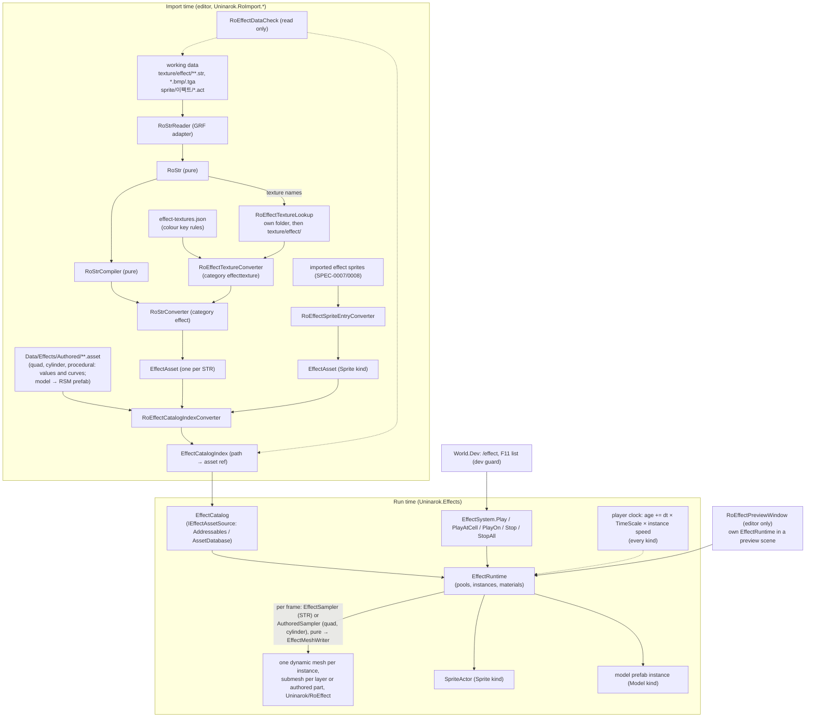

# PLAN-0012: Effects

| Implements | [spec.md](spec.md) (SPEC-0012, approved) | Status | Approved | Audience | Architects, senior devs, AI |
|---|---|---|---|---|---|

> This file defines **how**. Requirement IDs (`FR-n`) refer to `spec.md`. Shared import rules (paths, source, writer, ledger, report, batch, menu, placeholders) are [PLAN-0002](../0002-ro-import-foundation/plan.md); the one-asset-per-file pattern, `SpriteActor`/`SpriteSystem` and the preview pattern are [PLAN-0007](../0007-spr-act-pal-sprites/plan.md); effect sprites by name are [PLAN-0008](../0008-sprite-catalog/plan.md) (`SpriteCatalog.TryGetEffect`); models are [PLAN-0003](../0003-rsm-models/plan.md) (`RoImport.Model`); camera facing and the composer's preview stage are [PLAN-0009](../0009-unit-display/plan.md); the dev command line and dev tools attachment are [PLAN-0010](../0010-world-session/plan.md) §4.12. STR format facts, sampling semantics, blend codes, scale and the authored-entry rules (quad and cylinder sampling, §4.2) are documented in **[str-reference.md](str-reference.md)** (written in T0.1, normative for its topic, updated in the same commit as the code it describes).

## 1. Constraints and assumptions

Satisfies FR-1, FR-2, FR-3, FR-4, FR-7, FR-9, FR-10 (constraints all sections rely on).

- **No new package and no third-party library.** Every effect kind is drawn by our own player family with one hand-written URP shader: STR (D3, D15) and the authored kinds quad, cylinder and procedural (D5, FR-4, FR-7), on the same mesh writer, materials and pools; no particle system, no VFX Graph, no compute shader (owner decision 2026-11-24, spec FR-4 and §6), so effects run on every URP target the client runs on, `Mobile_RPAsset` included. `Packages/manifest.json` is unchanged; loading is Addressables (already used by PLAN-0008/0009); the STR file is read by the existing **GRF library** (`GRF.dll`, namespace `GRF.FileFormats.StrFormat`: `Str`, `StrHeader`, `StrLayer`, `KeyFrame`, `TextureNames`, `Fps`, `MaxKeyFrame`, `Layers`, `KeyFrames`, interpolation helpers; names seen in the DLL's metadata, members confirmed in T0.1). As PLAN-0002 §1 requires, importer code never parses file bytes; the one exception, as PLAN-0007 D11/D14(f) did for SPR, is a header check of the first 8 bytes (magic and version) to tell an unsupported version from a corrupt file.
- **STR facts verified on real bytes** (`sprite/이팩트/jong_mini.str`, read 2026-11-24): magic `STRM`, version `0x94`, frame rate 60, frame count 100, then the layer count and 16 reserved bytes; each layer lists its texture names in fixed 128-byte slots (`jong0001.bmp` … `jong0014.bmp`, `freeze_ice_part.bmp`), then its keyframes. **Lead facts** (roBrowserLegacy, used as facts, nothing copied): keyframe = frame, type (0 base, 1 per-frame delta), position (2 floats), uv (8), corners xy (8: four x then four y), aniframe, anitype (0..4), delay, angle (1024 units per turn), colour (4 floats, 0..255), source and destination blend (Direct3D blend codes), mtpreset; only version `0x94`; canvas 640 wide, art centre (320, 320) on the effect's position, half a cell lower; 35 STR pixels per cell; spherical billboard; the fragment drops pure black. Every lead value lands in data (§4.6 `EffectSettings`, str-reference.md) and is marked doubtful until T0.1/T7 confirm it. The keyframe interpolation rule derived from the lead is **accepted by the owner** (FR-3, D17); T0.1 still compares it with GRF's own interpolation and the owner confirms the result visually.
- **Working data state (Glob, 2026-11-24).** The owner has extracted the effect files: 2,995 `.str` under `texture/effect/` (311 at its root) plus `sprite/이팩트/jong_mini.str`; 21,757 image files under `texture/effect/`; 168 effect sprites already imported by SPEC-0007/0008 under `Art/Imported/sprite/이팩트/`; 179 files under `luafiles514/lua files/effecttool/` (per-map tool tables and their wavs). FR-1's check gives the authoritative counts (§4.9). The trap model of the must-list, `model/외부소품/트랩01.rsm`, is present (`Assets/Editor/GRF Resources~/data/model/외부소품/트랩01.rsm`). Textures exist under several folders with one name (`freeze_ice_part.bmp` in 28 folders) and with two extensions (`pok1.bmp` and `pok1.tga`, `met_ball.bmp` and `.tga`); per the spec (FR-2, §6) the two extensions are **different textures**, both imported, and a lookup by bare name prefers `.tga` (§4.3, D7, D16).
- **Texture lookup verified on two files**: `texture/effect/new_splash/new_splash.str` finds `splash_00…19.bmp` in its own folder; `sprite/이팩트/jong_mini.str` finds `jong0001.bmp` and `freeze_ice_part.bmp` only under `texture/effect/` (FR-2 order: own folder, then root).
- **Warp portal (FR-7)**: no STR in the data names a warp; the lead's effect for the warp NPC (`EF_WARPZONE2` in roBrowserLegacy's `src/DB/Effects/EffectTable.js`) is two `CYLINDER` parts on `texture/effect/ring_blue.tga` and one camera-facing textured quad (its `3D` part type) on `texture/effect/pok1.tga`, both present. So the warp portal's files are three **authored entries** (two `.cylinder`, one `.quad`) drawn by our own player (FR-4, FR-7, §4.7); no procedural code is needed for them.
- **Authored kinds, lead facts** (roBrowserLegacy `src/Renderer/Effects/Cylinder.js` and `Cylinder.vs`, `ThreeDEffect.js`, `src/Renderer/SpriteRenderer.js`; read 2026-11-24, facts only, nothing copied; every value lands in `EffectAsset` data, marked doubtful, §4.2, §4.7):
  - *Cylinder*: an open tube (no caps) of 20 sides by default, bottom ring at height 0 and top ring at `height`, bottom and top radius in cells around the effect position; texture u = side index / sides × a horizontal repeat (1 by default), v = 1 at the bottom and 0 at the top. Over one duration (normalised t ∈ [0, 1]) the warp's animation mode 3 scales both radii by (1 − t) and the height linearly up to its maximum at t = 0.5 and back to 0 at t = 1; `fade` raises alpha from 0 to `alphaMax` over the first quarter and lowers it to 0 over the last quarter; `rotate` spins it about the vertical axis; tint rgb; depth tested, no depth write.
  - *Camera-facing quad* (`3D` type): a billboard of `size` in sprite pixels (35 to a cell, as STR and sprites), tint rgb, alpha `alphaMax` with `fadeIn` over the first quarter and `fadeOut` over the last; position moved linearly over t from a start offset to an end offset, each drawn at random in a box once per play (D19) (warp sparkle: start x and y in ±3 cells, z 0; end x and y 0, z in 0..4 cells); angle constant or linear from `angle` to `toAngle`.
  - *Blend*: both draw with source factor SrcAlpha and destination factor picked by `blendMode` from the lead's own table (1 Zero, 2 One, 3 SrcColor, 4 OneMinusSrcColor, 5 DstColor, …), so the warp's `blendMode: 2` is SrcAlpha / One (additive). This table differs from the STR's Direct3D codes; authored assets store D3D codes (SrcAlpha = 5, One = 2) for the one `EffectBlend` table (§4.5), converted by hand when the entry is authored.
  - *Time*: duration in milliseconds, restarted while `repeat`; duplicates and their delays are SPEC-0014's per-part data (not here).
- Unity 6000.7.0b7, URP 17.7, main thread only for every Unity call (import, play, preview). Coordinates: 1 cube = 1 u, 1 GAT cell = 0.5 u (`RoUnits`); STR pixels → units by `EffectSettings.PixelsPerCell` (lead 35, so 1/70 u per pixel, the same ratio as sprites' 70 PPU).
- Dev-only code sits in the existing `Uninarok.World.Dev` assembly (`defineConstraints: UNITY_EDITOR || DEVELOPMENT_BUILD`) or in editor-only assemblies; nothing of FR-8/FR-11 is in `Uninarok.Effects`.

## 2. Architecture

Satisfies FR-1 to FR-11.



Data flow of `/effect texture/effect/firewall.str 150 180 loop`:

1. `EffectPath.Normalize` gives the canonical key; `EffectCatalog.TryResolve` finds the index entry (O(1)); unknown → placeholder instance and one warning (§4.4).
2. `EffectRuntime.Play` takes a pooled instance, records place (cell centre from `MapData.CellCenter`), loop flag, start time; if the asset is not loaded yet the instance waits on the catalog's load (Addressables), then starts.
3. Each `LateUpdate` (order 950): for every active instance, age += Δt × runtime `TimeScale` × the instance's speed (the play-speed multiplier of FR-4, default 1, §4.5), frame = age × fps (fractional); `EffectSampler` samples each layer; `EffectMeshWriter` writes 4 vertices per layer into the instance's preallocated `NativeArray`, uploads once, and swaps a submesh's material only when its (texture, blend) changed. The shader expands corners along the camera's right and up axes.
4. A one-shot instance whose frame passes its frame count returns to the pool; a looped one wraps.

For an authored entry (`/effect texture/effect/_authored/warp_portal/ring_outer.cylinder 150 180 loop`) steps 1, 2 and 4 are the same and the same clock runs; in step 3 the cycle position t = (age mod `Length`) / `Length` goes to `AuthoredSampler`, which evaluates the entry's curves and values (radii, height, alpha, rotation for a cylinder; position, size, alpha, angle for a quad) and the writer emits the cylinder strip or the quad into the same kind of pooled mesh with the same shader and materials (§4.5).

## 3. Assemblies and file layout

Satisfies FR-2, FR-4, FR-5, FR-7, FR-8, FR-10, FR-11.

| Assembly | Path | References | Contents |
|---|---|---|---|
| `Uninarok.Effects` (new, runtime, all platforms) | `Assets/Scripts/Effects/` | `Uninarok.Sprites`, `Uninarok.SpriteCatalog`, `Uninarok.Map`, `Unity.Addressables`, `Unity.ResourceManager` (no VFX, particle or compute API used, checked by `RoArchitectureTests`) | `Data/EffectAsset.cs`, `Data/AuthoredData.cs`, `Data/EffectCatalogIndex.cs`, `Data/EffectSettings.cs`; `Catalog/EffectPath.cs`, `EffectCatalog.cs`, `IEffectAssetSource.cs`, `AddressablesEffectSource.cs`; `Playback/EffectSampler.cs`, `AuthoredSampler.cs`, `EffectRandom.cs`, `EffectBlend.cs`, `EffectHandle.cs`, `EffectRuntime.cs`, `EffectInstance.cs`, `EffectMeshWriter.cs`, `EffectMaterials.cs`, `EffectProcedures.cs`, `EffectSystem.cs`, `EffectSystemDriver.cs`, `Parts/` (`StrPart`, `AuthoredPart`, `SpritePart`, `ModelPart`, `PlaceholderPart`) |
| — (runtime assets) | `Assets/Shaders/Effects/RoEffect.shader`; `Assets/Settings/Effects/EffectSettings.asset`; `Assets/Data/Effects/Authored/<catalog key>.asset` | — | shader `Uninarok/RoEffect` (§4.5, every mesh-drawn kind: STR, quad, cylinder, procedural); scale, pivot, placeholder, shader reference, authored frame rate (§4.6); authored entries (§4.7), one `EffectAsset` per catalog key at the path mirroring its key (`Data/Effects/Authored/texture/effect/_authored/warp_portal/ring_outer.cylinder.asset`), values and curves inside the asset; all hand-made, never under `Art/Imported` |
| `Uninarok.RoImport.Core` (changed) | `Assets/Editor/RoImport/Core/Formats/RoStrReader.cs`; `Core/Effects/` | + `Uninarok.Effects` (as D13 of PLAN-0007) | `RoStr`, `RoStrCompiler`, `RoEffectTextureLookup`, `RoEffectKeyRules`, `RoEffectDataCheck`; `Core/Imaging/RoColorKey.cs` gains a key-set overload |
| `Uninarok.RoImport.Editor` (changed) | `Assets/Editor/RoImport/Editor/Effects/` | + `Uninarok.Effects` | `RoStrConverter`, `RoEffectTextureConverter`, `RoEffectSpriteEntryConverter`, `RoEffectCatalogIndexConverter`, `RoEffectOutputPaths`, `RoEffectMenu`; `RoJobKind` gains `Effect`, `EffectSprites`, `EffectIndex`; `RoCatalogAddressables.Ensure` gains the `effects` group |
| — (import rules data) | `Assets/Editor/RoImport/Rules/effect-textures.json` | — | colour key rules (§4.3), editor only |
| `Uninarok.Effects.Editor` (new, `includePlatforms: [Editor]`) | `Assets/Scripts/Effects/Editor/` | Effects, Sprites, SpriteCatalog, `Uninarok.RoImport.Core`, `Uninarok.RoImport.Editor` (GRF DLLs not referenced) | `RoEffectPreviewWindow`, `EffectPreviewStage`, `AssetDatabaseEffectSource`, `EffectAssetEditor` (inspector with "Open preview") |
| `Uninarok.World.Dev` (changed, dev guard by `defineConstraints`) | `Assets/Scripts/World/Dev/` | + `Uninarok.Effects`, `Uninarok.Units` | `EffectDevCommands.cs` (`/effect`), `EffectDebugView.cs` (F11 list); `WorldDevTools.Attach` adds them |
| Tests | `Assets/Tests/EditMode/RoImport/Effects/` (in `Uninarok.RoImport.Tests`), `Assets/Tests/EditMode/Effects/` (new `Uninarok.Effects.Tests`), `Assets/Tests/PlayMode/Effects/` (new `Uninarok.Effects.PlayTests`), `Assets/Tests/EditMode/World/` (command parsing) | — | §6 |

Outputs (roots of PLAN-0002 §4.5; `Art/Imported/effect/` joins the reserved generated paths):

| Output | Path | Owner |
|---|---|---|
| STR asset | `Art/Imported/effect/<canonical path>.asset`, extension kept: `…/effect/texture/effect/firewall.str.asset` | ledger `effect` |
| Effect texture | `Art/Imported/effect/<canonical path>.png`, extension kept: `…/effect/texture/effect/pok1.tga.png` (D7) | ledger `effecttexture` |
| Sprite entry | `Art/Imported/effect/sprite/이팩트/<name>.act.asset` | ledger `effect` |
| Catalog index | `Art/Imported/effect/_index.asset` | ledger entry `effect/_index` |
| Reference doc | `docs/specs/0012-effects/str-reference.md`; evidence in `docs/specs/0012-effects/evidence/` | hand-written |

Addressables: one group `effects` with folder entries `Assets/Art/Imported/effect` and `Assets/Data/Effects` (address = project path, as PLAN-0008 D13); textures and prefabs come in as dependencies.

## 4. Component contracts

### 4.1 STR adapter and data: `RoStrReader`, `RoStr`

Satisfies FR-2, FR-10.

```csharp
public sealed class RoStr
{
    public int Version; public float Fps; public int FrameCount;          // header: version, fps, max key
    public IReadOnlyList<RoStrLayer> Layers;                               // file order
}
public sealed class RoStrLayer { public IReadOnlyList<string> TextureNames; public IReadOnlyList<RoStrKey> Keys; }  // names as stored (decoded CP949)
public readonly struct RoStrKey
{
    public readonly int Frame, Type;                                       // Type 0 base, 1 delta
    public readonly Vector2 Position;
    public readonly Vector2 Uv0, Uv1, Uv2, Uv3;                            // order fixed by T0.1
    public readonly Vector2 Xy0, Xy1, Xy2, Xy3;                            // corner i = (x[i], y[i]); pixels, y down
    public readonly float AniFrame; public readonly int AniType; public readonly float Delay;
    public readonly float Angle;                                           // raw file units
    public readonly Vector4 Color;                                         // raw, 0..255
    public readonly int SrcBlend, DstBlend, MtPreset;                      // raw codes
}
public static class RoStrReader
{
    public static bool TryReadVersion(byte[] bytes, out int version);      // magic + version only (header check)
    public static bool TryRead(RoPath path, byte[] bytes, out RoStr str, out string reason);   // never throws
}
```

- GRF mapping (T0.1, recorded in str-reference.md as a table like PLAN-0007 §4.1): which GRF member holds each field, uv and xy order, angle units, colour range, texture name encoding, whether GRF's interpolation API matches the lead semantics (§4.2), the versions present in the whole data set, and whether a layer's blend codes vary between its keys. Values stay raw; rules live in the sampler and settings.
- Bad input: wrong magic or truncated → `CorruptFile` with GRF's message; magic right but version not supported → `UnsupportedStrVersion` (new `RoIssueCode`). Both are one issue and no output; the batch continues.

### 4.2 Effect asset and sampler: `EffectAsset`, `RoStrCompiler`, `EffectSampler`

Satisfies FR-2, FR-3, FR-4, FR-5.

```csharp
namespace Uninarok.Effects
{
    public enum EffectKind : byte { Str, Sprite, Quad, Cylinder, Model, Procedural }
    public enum EffectFacing : byte { Camera, Ground }

    public sealed class EffectAsset : ScriptableObject
    {
        public string Path;                 // canonical catalog key (§4.4)
        public EffectKind Kind;
        public float Fps; public int FrameCount;                 // length = FrameCount / Fps seconds
        public LayerData[] Layers;
        public KeyData[] Keys;                                   // flat, by layer (STR)
        public string[] TextureNames;                            // flat, by layer, as the file names them
        public Texture2D[] Textures;                             // parallel to TextureNames; the placeholder where missing
        public AuthoredData Authored;                            // Quad / Cylinder / Procedural: our own authored data (FR-4)
        public float Length;                                     // authored kinds and Model: seconds of one cycle at speed 1
        public string SpriteName; public int SpriteAction;       // Sprite kind: SPEC-0008 name, action
        public GameObject Model;                                 // Model kind: SPEC-0003 prefab
        public string[] Doubtful;                                // "field: reason (lead / unverified)", authored only

        [Serializable] public struct LayerData { public int FirstKey, KeyCount, FirstTexture, TextureCount; }
        [Serializable] public struct KeyData                                  // what the file holds, raw; blend per key (FR-2)
        {
            public int Frame; public byte Type, AniType, SrcBlend, DstBlend; public int MtPreset;
            public Vector2 Position, Uv0, Uv1, Uv2, Uv3, Xy0, Xy1, Xy2, Xy3;
            public float AniFrame, Delay, Angle; public Vector4 Color;
        }
    }

    // Data/AuthoredData.cs: values no file holds, from the client data and leads (FR-4, FR-5); curves over t ∈ [0, 1] of one cycle
    [Serializable] public sealed class AuthoredData
    {
        public EffectFacing Facing;                              // Quad: Camera or Ground; Cylinder: always Ground (object space)
        public int Texture = -1;                                 // index into EffectAsset.Textures; -1 or missing → placeholder texture
        public byte SrcBlend = 5, DstBlend = 6;                  // D3D codes, the one EffectBlend table (lead SrcAlpha/One → 5/2, §1)
        public Color Tint = Color.white; public float MaxAlpha = 1f;
        public AnimationCurve Alpha;                             // × MaxAlpha; null = constant 1
        public AnimationCurve Rotation;                          // degrees (quad: in its plane; cylinder: about the vertical axis); null = 0
        // Quad
        public float SizePixels = 35f;                           // STR pixels, → units by EffectSettings.PixelsPerCell
        public AnimationCurve SizeScale;                         // null = 1
        public Vector3 StartMin, StartMax, EndMin, EndMax;       // offset box in cells (x, y on the ground, z up), drawn once per play (D19)
        public AnimationCurve Motion;                            // 0 = start offset, 1 = end offset; null = linear
        // Cylinder
        public float BottomRadius, TopRadius, Height;            // cells
        public int Sides = 20; public float RepeatU = 1f;        // lead defaults
        public AnimationCurve RadiusScale, HeightScale;          // × both radii, × height; null = 1
        // Procedural
        public string Procedure;                                 // name in EffectProcedures; null or unknown → placeholder, one warning (D20)
    }

    public struct QuadSample { public Vector2 C0, C1, C2, C3, Uv0, Uv1, Uv2, Uv3, Position; public float AngleDegrees; public Color Color; public int Texture; public byte Src, Dst; }
    public struct AuthoredQuadSample { public Vector3 Offset; public float Size, AngleDegrees; public Color Color; }   // Offset in units
    public struct CylinderSample { public float Bottom, Top, Height, AngleDegrees; public Color Color; }               // units

    public static class EffectSampler                                        // STR; pure, no allocation
    {
        public static bool Sample(EffectAsset asset, int layer, float frame, ref int cursor, out QuadSample q);  // false = layer hidden at this frame
        public static float Length(EffectAsset asset);                       // FrameCount / Fps
    }
    public static class AuthoredSampler                                      // Quad, Cylinder; pure, no allocation
    {
        public static void SampleQuad(AuthoredData d, EffectSettings s, float t, uint seed, out AuthoredQuadSample q);
        public static void SampleCylinder(AuthoredData d, EffectSettings s, float t, out CylinderSample c);
    }
    public static class EffectRandom { public static float Range(uint seed, int channel, float min, float max); }   // hash of the instance seed, no state; once per play (D19)
    public interface IEffectProcedure { int MaxQuads { get; } void Write(AuthoredData d, float t, uint seed, int cycle, ref EffectQuadSpan quads); }
    public static class EffectProcedures { public static bool TryGet(string name, out IEffectProcedure p); }   // empty registry in this spec (D20)
}
```

- **No sound, no play data** in the asset (FR-2, FR-5): no asset-level start delay, duplicate, wav/sound, attachment or id field (those are authored mapping data of another spec); a reflection test checks the type's fields. **`KeyData.Delay` stays**: it is the STR file's own per-key animation delay (used by anitype 2, essential for correct timing), imported from the file as it is, and the reflection test allows it explicitly.
- **Compiler** (`RoStrCompiler.Compile(RoStr) → RoCompiledStr` with the runtime `LayerData`/`KeyData` arrays, D13 pattern): flattens layers, keeps every key in file order sorted by frame (stable), keeps texture names. No value is converted.
- **Sampling semantics** (lead, accepted by the owner, D17; pinned by tests and str-reference.md; T0.1 checks it against GRF's own interpolation API, which becomes the offline oracle if they agree, and any difference is reported to the owner, who decides from the preview images): at fractional frame f, the base key is the last type-0 key with `Frame ≤ f`; none → hidden. If the next key is type 1 at the same frame, values = base + delta × (f − base.Frame) for position, uv, corners, angle, colour; aniframe by the delta key's anitype (0 → 0, 1 → base + delta.aniframe × d, 2 → min(base + delay × d, n − 1), 3 → wrap modulo n, 4 → reverse, wrapped positive); otherwise the base key's values are held. Hidden after the last key when no delta key carries it on. Blend = the base key's codes. Angle → degrees by `EffectSettings.AngleUnitsPerTurn` (lead 1024), colour / 255.
- **`cursor`** caches the base key index per instance and layer, so sampling is O(1) amortised; a seek resets it (sampling stays a pure function of the frame, which the preview scrubber needs).
- **Authored kinds** (Quad, Cylinder, Procedural, FR-4) are sampled by `AuthoredSampler`, not `EffectSampler`. Everything that shapes them is data in the `EffectAsset`: the values no file holds (texture, blend, tint, maximum alpha, size, radii, height, sides, offset boxes, cycle `Length`) and the motion over one cycle as `AnimationCurve`s (alpha, rotation, size, motion, radius and height scale), edited in the inspector (D5). So "changing an asset's length or texture changes what plays with no code change" (FR-5) holds for authored entries too, and there is no second asset type to keep in step with the entry.
- **Authored sampling rules** (pure, pinned by `AuthoredSamplerTests`, written down in str-reference.md's authored-entry section): t ∈ [0, 1] is the cycle position; a null curve is its neutral value (1 for scales and alpha, 0 for rotation, linear for motion); colour = `Tint` with alpha = `MaxAlpha` × `Alpha(t)`, clamped to [0, 1]. Quad: offset = lerp(start, end, `Motion(t)`) with start and end drawn in their boxes by `EffectRandom` from the instance seed only (once per play, the same in every cycle), cells → units by `RoUnits` (x, y on the ground plane, z up); size = `SizePixels` × `SizeScale(t)` / `PixelsPerCell` cells; angle = `Rotation(t)`. Cylinder: bottom = `BottomRadius` × `RadiusScale(t)`, top = `TopRadius` × `RadiusScale(t)`, height = `Height` × `HeightScale(t)`, angle = `Rotation(t)`, all cells → units. The lead's numbered cylinder animation modes and its fade quarters are not code: each authored entry carries them as curve keys (the warp's in §4.7), so a new look is a new curve, not a new mode.
- **Procedural** entries name a C# procedure (`AuthoredData.Procedure`) registered in `EffectProcedures`; a procedure writes quads through the same writer (`EffectQuadSpan`, §4.5) from the entry's data, t, seed and cycle. The must-list needs none, so the registry is empty in this spec and every procedural entry plays the placeholder with one warning (FR-4, D20).

### 4.3 Effect textures: `RoEffectTextureLookup`, `RoEffectKeyRules`, `RoEffectTextureConverter`

Satisfies FR-1, FR-2.

```csharp
public static class RoEffectTextureLookup                       // pure
{
    public static readonly RoPath EffectRoot;                   // "texture/effect"
    public static readonly string[] BareNamePreference = { ".tga", ".bmp" };   // FR-2: by name alone, .tga first
    public static bool TryResolve(IRoSource src, RoPath str, string name, out RoPath texture);   // own folder, then EffectRoot
}
public enum RoEffectKey : byte { None, Pink, Black, PinkAndBlack }
public sealed class RoEffectKeyRules                            // loaded from Rules/effect-textures.json
{
    public RoEffectKey DefaultOpaque;                          // BMP, 24-bit TGA, JPG
    public RoEffectKey DefaultWithAlpha;                       // 32-bit TGA, PNG with alpha (None by PLAN-0002 D17)
    public byte PinkTolerance = 10, BlackTolerance;            // per channel
    public (RoPath Path, RoEffectKey Key)[] Overrides;         // per texture
    public RoEffectKey For(RoPath texture, bool sourceHadAlpha);
}
public static class RoColorKey { public static RoTextureAlpha Apply(RoImage image, RoKeySet keys); }   // new overload; old Apply unchanged
// RoImportContext gains: RoResult<Texture2D> EffectTexture(RoPath path, string referrer);   memoised per run
```

- **Lookup** order is FR-2's: own folder, then `texture/effect/`. A name **with** an extension resolves to exactly that file (`pok1.bmp` never finds `pok1.tga`); a name **without** one tries `.tga` then `.bmp` in the own folder, then the same in the root (so an own-folder `.bmp` still beats a root `.tga`: folder order first, extension preference within a folder; recorded in str-reference.md, D16). A name found in neither folder gives `TextureMissing` once per (texture, STR) with the STR as referrer, and the placeholder (`RoPlaceholders.MissingTexture`) is stored in the asset's `Textures` slot, its `TextureNames` entry kept.
- **Converted once, shared**: one output per resolved source path (`effecttexture` ledger, memoised per run); every STR naming that path references the same texture. Content-identical copies in other folders stay separate textures (R6).
- **Own category, extension kept** (D7, FR-2): effect textures do not go through `RoTextureConverter`, so world textures keep their SPEC-0002 rule (one texture per name, `.bmp` preferred, PLAN-0002 D19), and for this category `pok1.bmp` / `pok1.tga` are two different textures, both imported, with no `OutputCollision` warning. The two rules differ on purpose: the spec sets the effect rule for this category only.
- **Colour key (FR-2, data in one place)**: `effect-textures.json` holds the defaults, tolerances and per-texture overrides; the applied key is written into the importer `userData` (`alpha=…;key=…`), so the preview shows it and a rules change re-converts only the textures whose key changed (the converter compares the stored key with `RoEffectKeyRules.For`). Bleed as PLAN-0002 §4.4. The default values come from **T0.2** (data survey: background colour of every effect texture against the blends of the layers that use it), decided by the owner; if T0.2 finds the rule follows the layer's blend rather than the texture, the rules gain a `ByBlend` entry computed by the index step from the texture's users, with one warning where users disagree (D6, R2).
- Import settings: Default type, sRGB, alpha is transparency, mipmaps on, bilinear, **clamp**, normal compression, non-power-of-two kept.

### 4.4 Catalog: `EffectPath`, `EffectCatalogIndex`, `EffectCatalog`, index and sprite entries

Satisfies FR-1, FR-4, FR-5, FR-6.

```csharp
public static class EffectPath
{
    public static bool TryNormalize(string raw, out string key);   // own light runtime normalisation (below, D21); no reference to RoPath
    public static readonly string[] Prefixes = { "", "texture/effect/", "texture/", "sprite/" };   // relative forms the client data uses
}
public sealed class EffectCatalogIndex : ScriptableObject { public string[] Keys; public EffectAssetRef[] Assets; public bool[] SourceMissing; }   // sorted by key
[Serializable] public struct EffectAssetRef { public string Guid; }                                   // Addressables key = GUID, as PLAN-0008
public interface IEffectAssetSource { void Load(EffectAssetRef r, Action<EffectAsset> done); void Release(EffectAssetRef r); }
public sealed class EffectCatalog
{
    public static AsyncOperationHandle<EffectCatalog> LoadAsync();          // index through Addressables (game)
    public static EffectCatalog Create(EffectCatalogIndex index, IEffectAssetSource source);   // editor, tests
    public bool TryResolve(string path, out EffectRef entry);               // O(1) after the first call for that string
    public void Release();
}
public readonly struct EffectRef { public readonly int Index; }
```

- **Runtime normalisation** (`EffectPath.TryNormalize`, D21): `RoPath` (`Assets/Editor/RoImport/Core/Paths/RoPath.cs`) is import-time normalisation and editor code, which `Uninarok.Effects` must not reference (§3). `EffectPath` therefore does its own light normalisation: `'\'` → `'/'`, repeated slashes collapsed, whitespace trimmed, leading separators stripped, invariant lowercase, and the known leading prefixes stripped (`data/`); the root of every key is the folder the effect files are extracted to (the working data root for effects), so keys are relative to it, as RoPath's canonical paths are. Empty input, `.`/`..` segments or a drive letter → false. Import code may call `RoPath` and gets the same key; `EffectPathAgreementTests` (§6) asserts that both give the same string on a pinned sample set (case, backslashes, `data\` prefix, leading separators, Korean `sprite/이팩트/…` names, deep folders).
- **Key** = the canonical full path (`texture/effect/firewall.str`, `sprite/이팩트/fireball.act`, `texture/effect/_authored/warp_portal/ring_outer.cylinder`). A lookup tries the raw path normalised, then each prefix in order, so `effect/firewall.str`, `FIREWALL.STR` and `data\texture\effect\firewall.str` reach one entry (FR-5). The first raw string of each lookup is cached (`Dictionary<string, int>`, ordinal), so repeated play allocates nothing (FR-9).
- **Index step** (`RoEffectCatalogIndexConverter`, last job of an effect import, also on its own menu item): scans `Art/Imported/effect/**` and `Data/Effects/Authored/**` for `EffectAsset`s; one key per asset; two assets with one key → `EffectKeyDuplicate` warning, the ordinal-first asset path wins; `SourceMissing[i]` = the asset's source file is gone from the working data (generated assets only). The index repeats no effect content (FR-5): keys and references only. Rewritten only when it changes.
- **Authored entries in the same key space** (FR-4, FR-5): an authored `EffectAsset` carries its key in `Path` (authored keys live under `texture/effect/_authored/…`, with the part kind as extension: `.quad`, `.cylinder`, `.proc`; models keep their file path, `model/…/*.rsm`); it is stored at `Data/Effects/Authored/<key>.asset`, and the index step warns (`EffectKeyDuplicate` family, code `EffectKeyPathMismatch`) when the file location and `Path` disagree. An authored entry is self-contained (values and curves in the asset); entries share only converted textures (both warp cylinders reference `texture/effect/ring_blue.tga`).
- **Sprite entries** (`RoEffectSpriteEntryConverter`): one small `EffectAsset` (Kind `Sprite`, `SpriteName` = the SPEC-0008 effect name, `SpriteAction` 0) per ACT under `sprite/이팩트/`; it references the sprite by name and imports nothing (FR-4).
- **Unknown path, missing source, unbuilt kind**: play shows the placeholder part and logs one warning per key per session (`HashSet<string>` of warned keys; allocation only on the first warning).

### 4.5 Player: `EffectRuntime`, `EffectSystem`, parts, mesh, shader

Satisfies FR-3, FR-4, FR-6, FR-7, FR-9.

```csharp
public readonly struct EffectHandle { public readonly int Slot, Generation; public bool IsValid { get; } }
public enum EffectPlace : byte { Point, Cell, Unit }

public sealed class EffectRuntime                       // one per world: the game's (EffectSystem) or a preview's
{
    public EffectRuntime(EffectCatalog catalog, EffectSettings settings, Transform root, int capacity = 512);
    public float TimeScale { get; set; }                 // whole runtime: preview speed, pause (0); default 1
    public void SetSpeed(EffectHandle h, float speed);   // FR-4 play-speed multiplier of one effect, any kind; default 1, clamped ≥ 0
    public float SpeedOf(EffectHandle h);
    public EffectHandle Play(EffectRef effect, Vector3 point, bool loop = false);
    public EffectHandle PlayOn(EffectRef effect, Transform unit, bool loop = false);   // follows position, not rotation
    public EffectHandle PlayAtCell(EffectRef effect, MapData map, int x, int y, bool loop = false);   // MapData.CellCenter
    public void Stop(EffectHandle h); public void StopAll();
    public bool IsActive(EffectHandle h); public int ActiveCount { get; }
    public void Seek(EffectHandle h, float seconds);     // preview: exact frame, cursors reset
    public float FrameOf(EffectHandle h);
    public void Tick(float deltaSeconds);
}
public static class EffectSystem                         // [AutoStaticsCleanup]; the game's runtime, driven by a hidden EffectSystemDriver
{
    public static EffectCatalog Catalog { get; set; }
    public static EffectHandle Play(string path, Vector3 point, bool loop = false);   // + PlayOn, PlayAtCell, SetSpeed, Stop, StopAll, IsActive, ActiveCount
}
public ref struct EffectQuadSpan { public void Quad(in AuthoredQuadSample q, EffectFacing facing, int texture, byte src, byte dst); }   // writer view for procedures (D20)
```

- **Player clock** (FR-4, FR-6, D14): every instance, whatever its kind, keeps `Age` in effect seconds: each tick `Age += Δt × TimeScale × Speed`. Everything derives from `Age`: the STR frame (`Age × Fps`), the authored cycle position t, the sprite step (`SpriteActor.Step(Δt × TimeScale × Speed)`), the model's end, the placeholder's end. So speed 2 halves the wall time of one cycle for every kind, and `Seek` sets `Age` directly (exact, no simulation). The multiplier is per instance (set by the caller, the preview's speed control, the tests), not a field of the asset, so STR assets keep only what the file holds (FR-2).
- **Parts** (§3): `StrPart` writes 4 vertices per layer; `AuthoredPart` (Quad, Cylinder, Procedural) writes its quad, cylinder strip or procedure quads (below); `SpritePart` drives a pooled `SpriteActor` (SPEC-0007) with the animation found through `SpriteCatalog.TryGetEffect` (game) or `RoCatalogLookupWindow.LoadInEditor` (preview), advanced by `SpriteActor.Step` from the runtime's tick, so pause, seek and speed hold for it too (PLAN-0007 D15); `ModelPart` instantiates the prefab once per pooled slot; `PlaceholderPart` is a camera-facing quad of `EffectSettings.PlaceholderTexture`, `PlaceholderSeconds` long (or looped). The `Procedural` kind draws through a registered `IEffectProcedure`; none is built in this plan (the must-list needs none), so a procedural entry plays the placeholder with one warning (FR-4, D20).
- **`AuthoredPart`** (FR-4, FR-6, FR-7, FR-9): a sibling of `StrPart` in the same family; same pooled instance object, mesh writer, shader, materials and clock. Per tick: t = (`Age` mod `Length`) / `Length` (looped) or `Age` / `Length` clamped (one-shot), cycle index = ⌊`Age` / `Length`⌋; then
  - *Quad*: `AuthoredSampler.SampleQuad` → 4 vertices, centred on the effect position plus the offset, corners ± size / 2 rotated by the angle; camera-facing with the `_FACING_CAMERA` keyword (expanded in the shader like STR layers), ground-facing flat on xz; uv the full rectangle.
  - *Cylinder*: `AuthoredSampler.SampleCylinder` → `(Sides + 1) × 2` vertices (bottom ring at y 0, top ring at `Height`, radius per ring, rotated about y by the angle), u = i / `Sides` × `RepeatU`, v 1 at the bottom and 0 at the top (§1 lead facts), object space, `Cull Off` so the inside shows; texture wrap repeat only when `RepeatU` > 1: the converted effect textures are clamp (§4.3), so such an entry's material enables the shader keyword `_UV_REPEAT`, which samples through an inline repeat sampler state (wrap is part of the material key).
  - *Procedural*: the procedure writes up to `MaxQuads` quads through `EffectQuadSpan`.
  - Index buffers: the quad and each cylinder side count have one static index layout, written into the instance mesh with `SetIndexBufferData` from a preallocated `NativeArray<ushort>` when the instance is bound to the asset at start (no allocation after warm-up for a side count already seen), not every frame.
  - Each authored entry is one submesh with one material (texture, blend, facing, wrap); random values come from `EffectRandom` with the instance seed only (the handle's slot and generation hashed with the key), so they are drawn once per play: a looped sparkle repeats the same path every cycle, and a seek or a test sees the same picture for the same time (D19).
- **Mesh** (`EffectMeshWriter`): per pooled instance one `GameObject` (`MeshFilter`, `MeshRenderer`, no shadows, no light probes) with one `Mesh` of fixed vertex format (float3 position, float2 uv, `Color32`; 24 bytes), one submesh per STR layer in file order or per authored part, a preallocated `NativeArray<EffectVertex>` sized to the largest vertex count seen (4 per STR layer, a cylinder strip, a procedure's quads; grows only at warm-up), uploaded with `SetVertexBufferData` and `MeshUpdateFlags` that skip validation and bounds (bounds set once from the asset). A hidden layer writes a zero-area quad. Materials go through `Renderer.SetSharedMaterials(List<Material>)` with a reused list, **only when a layer's (texture, blend, facing) changed**; blend comes from each layer's current base key, so a layer whose keys change blend swaps its submesh material at that key (FR-2, FR-3). Order of layers inside an instance relies on submesh order (T0.3 checks the order **and measures** its cost; one renderer per layer is avoided and is a fallback only if T0.3 shows submesh order fails and measures the fallback within FR-9, D4).
- **STR placement**: corner = rotate(Xy_i, angle) + (Position − `Pivot`), in pixels with y down, × `1 / (PixelsPerCell / GatCell)` → units, y flipped, then lowered by `VerticalBaseCells × GatCell`; `Pivot`, `PixelsPerCell`, `VerticalBaseCells`, `AngleUnitsPerTurn` are `EffectSettings` data (FR-3 "world scale set as data in one place").
- **Shader `Uninarok/RoEffect`** (hand-written, committed): URP unlit, transparent queue, `Blend [_SrcBlend] [_DstBlend]`, `ZWrite Off`, `Cull Off`, `ZTest LEqual`, vertex colour × texture, SRP Batcher compatible (no property blocks). Keywords `_FACING_CAMERA` and `_UV_REPEAT` (authored cylinders, §4.5 above). `_FACING_CAMERA`: the vertex's x, y are expanded along the camera's right and up axes from the object origin (spherical billboard, like units' full camera rotation, PLAN-0009 §4.6); without it the mesh is drawn in object space (ground quads, cylinders, flat on xz). A clip-space depth bias `_DepthBias` toward the camera (as `Uninarok/RoSprite` D7 of PLAN-0009) keeps ground-touching billboards from being cut; value in `EffectSettings`.
- **Blend** (`EffectBlend.ToUnity(byte code)`): Direct3D codes 1 Zero, 2 One, 3 SrcColor, 4 OneMinusSrcColor, 5 SrcAlpha, 6 OneMinusSrcAlpha, 7 DstAlpha, 8 OneMinusDstAlpha, 9 DstColor, 10 OneMinusDstColor, 11 SrcAlphaSaturate; any other code → SrcAlpha/OneMinusSrcAlpha with one warning per asset (format fact, a table pinned by a test, str-reference.md).
- **Materials** (`EffectMaterials`): one material per (texture, src, dst, facing, wrap), shared by STR layers and authored parts alike, created on first use and kept (allocation only at warm-up); the shader comes from `EffectSettings.Shader` (a serialized reference, so builds include it).
- **Length and loop** (FR-3, FR-6): all on the one clock (`Age`, effect seconds): a one-shot ends when `Age` ≥ `FrameCount / Fps` (STR), ≥ `Length` (authored kinds and model) or ≥ the action length (sprite), so its wall time is that length / speed; a loop wraps (STR frame modulo `FrameCount`, authored t modulo 1 with a new cycle index). **Stop** (FR-6 "at once") returns the instance to the pool in the same call; nothing of it draws in the next frame.
- **Pool** (FR-9): instance slots, meshes, native vertex and index arrays, sprite actors and model instances are pooled by the runtime; `Stop` returns them; no `Instantiate`/`Destroy`/`AddComponent` after warm-up for a kind and size already seen.
- **0 B per frame, how it holds and how it is verified** (FR-9): the per-frame C# path is `Tick` over a preallocated slot array (no LINQ, no closures, no boxing, no string building; warnings only on first occurrence); `AnimationCurve.Evaluate` and `EffectRandom` allocate nothing; uploads go from native arrays. Verified by `EffectAllocationTests`: `ProfilerRecorder` on `GC.Alloc` (main thread) over the **whole player frame** (not only `Tick`, so renderer callbacks count), compared with a baseline of the same scene with no effects (the difference must be 0 B), under the FR-9 mix including authored cylinders and quads, and during 1,000 starts and stops after warm-up; plus the owner's Profiler capture saved as evidence, with frame time.

### 4.6 Settings: `EffectSettings`

Satisfies FR-3, FR-4, FR-11.

```csharp
[CreateAssetMenu] public sealed class EffectSettings : ScriptableObject
{
    public Shader Shader;                       // Uninarok/RoEffect
    public float PixelsPerCell = 35f;           // lead; doubtful until T7 owner check
    public Vector2 Pivot = new Vector2(320, 320);
    public float VerticalBaseCells = 0.5f;      // lead
    public float AngleUnitsPerTurn = 1024f;     // lead, T0.1
    public float DepthBias = 0.5f;
    public Texture2D PlaceholderTexture; public float PlaceholderSeconds = 1f;
    public float AuthoredFrameRate = 60f;       // preview frame step and frame number for authored entries (lead: client tick 1/60 s) (FR-11)
}
```

The asset at `Assets/Settings/Effects/EffectSettings.asset` is the one place for scale and facing values; every value from a lead carries a tooltip naming its source and stays listed in str-reference.md until confirmed.

### 4.7 Must-list and authored entries

Satisfies FR-4, FR-5, FR-7.

| Part kind | Catalog key | Source | Notes |
|---|---|---|---|
| STR | `texture/effect/firewall.str` | data | also a reference file |
| SPR/ACT | `sprite/이팩트/fireball.act` | SPEC-0007/0008 import | sprite entry (§4.4) |
| Textured quad | `texture/effect/_authored/warp_portal/sparkle.quad` | authored, texture `texture/effect/pok1.tga` | warp portal part; camera-facing, `SizePixels` 50, tint (0.9, 1, 0.9), `MaxAlpha` 1, `Alpha` curve 0 → 1 over t 0..0.25, 1 until 0.75, → 0 at 1 (lead fade in and out); start box x, y ∈ [−3, 3] cells, z 0; end box x, y 0, z ∈ [0, 4] cells; `Motion` linear; `Rotation` none; `Length` 1 s; blend SrcAlpha / One (5 / 2) (lead values, doubtful) |
| Cylinder | `texture/effect/_authored/warp_portal/ring_outer.cylinder` | authored, texture `texture/effect/ring_blue.tga` | warp portal part; `BottomRadius` 2, `TopRadius` 3.3, `Height` 1.1 (cells), `Sides` 20, `RepeatU` 1, tint (0.5, 0.5, 1), `MaxAlpha` 0.4 with the same fade curve as the sparkle; `RadiusScale` 1 → 0 linear over the cycle and `HeightScale` 0 → 1 at t 0.5 → 0 at 1 (the lead's animation mode 3 as curve keys); `Rotation` none; `Length` 4 s; blend SrcAlpha / One (5 / 2) (lead values, doubtful) |
| Cylinder | `texture/effect/_authored/warp_portal/ring_inner.cylinder` | same texture | `BottomRadius` 1.9, `TopRadius` 3.2, otherwise as above |
| Model | `model/외부소품/트랩01.rsm` | authored, prefab from `RoImport.Model` | the lead's only model effect (`ef_trap_01`); present in the working data; `Length` authored (doubtful) |

- The **warp portal's files** (FR-7) are the three `_authored/warp_portal/*` entries over two shared textures. The lead plays each part several times with delays (duplicates 4 every 1 s for the rings, 5 every 0.3 s for the sparkle); duplicates and delays are SPEC-0014's per-part data, so here each plays alone, looped, as FR-7 says. The lead's `zIndex`, `renderBeforeEntities` and `attachedEntity` flags are draw-order and placement data, not modelled here: listed in `Doubtful` and judged by the owner from the images (R8).
- Authored textures: an authored entry names its textures in `TextureNames` (full effect texture paths, `texture/effect/ring_blue.tga`); the effect import (§4.10) also converts every texture an authored entry names (same `effecttexture` category and output, §4.3), and the entry's `Textures` slot references that output; `AuthoredAssetTests` checks that name and reference agree.
- Each authored entry is our own data (an `EffectAsset` edited in the inspector, curves included), reviewed like code; nothing of the lead's code is copied, only its values, each listed in `Doubtful` with its source.
- **Reference STR set** (FR-2, FR-3, FR-11): `texture/effect/firewall.str`, `cross.str`, `angelus.str`, `cure.str`, `freeze.str`, `bs_refinesuccess.str`, `dust.str` (all under `texture/effect/`), `texture/effect/new_splash/new_splash.str` (textures in its own folder), `texture/effect/mineffect/new_earthgrave/new_earthgrave_bottom/new_earthgrave_bottom.str` (deep folder), `sprite/이팩트/jong_mini.str` (textures only under the root). T0.1 records their counts; a file GRF rejects is replaced and the change noted in §8.
- Authored assets are hand-made data (not generated): each value no file holds comes from the client data where it exists (texture names, effecttool tables) or from the lead, and is listed in `Doubtful` with its source. They are reviewed like code.

### 4.8 Dev tools: `/effect`, effect list

Satisfies FR-6, FR-7, FR-8.

- `EffectDevCommands.Register(DevCommandLine line, WorldBootstrap world)` adds `AddWithArguments("/effect", …)`. Parsing is a pure function `EffectCommand.TryParse(string args, out EffectCommand cmd, out string error)` (kinds `PlayOnSelf`, `PlayAtCell`, `Stop`), test-first. The whole argument `stop` (case-insensitive, unquoted, nothing else) is `Stop`; a path literally named `stop` must be quoted (no client effect file has that name). Otherwise parsing runs from the end, because paths contain spaces (`blast mine.str`, `fire dragon.str`): a last token `loop` sets loop; then two trailing integers are a cell; the rest, trimmed, is the path; quotes around the path are allowed. Forms: `/effect <path> [loop]` → `PlayOn(own unit's transform)` (`world.Presenter.ViewOf(ownId)`), `/effect <path> <x> <y> [loop]` → `PlayAtCell(world.Map, x, y)`, `/effect stop` → stops every effect the dev tools started (FR-8). Messages: unknown path, no map, no character, "playing <key>", "stopped <n>".
- The dev tools keep the handles they started in a preallocated list; `stop` calls `EffectSystem.Stop` on each and clears it (dev tools are the only player in this spec, so it equals `StopAll`, but stays limited to its own handles for when SPEC-0015 plays effects too).
- On first use it loads `EffectCatalog.LoadAsync()` and sets `EffectSystem.Catalog`; the game itself never loads effects in this spec, so a release build has no effect code path at all.
- Map change: the dev tools call `EffectSystem.StopAll()` when the bootstrap loads another map (effects on cells of the old map would float).
- `EffectDebugView` (F11, same canvas pattern as `WorldDebugView`, text rebuilt 4 times a second): per active effect key, place (point, cell x y, or unit name), part count (layers), age in seconds. It reads `EffectSystem.FillDebug(List<EffectDebugInfo>)`, which is compiled only under `#if UNITY_EDITOR || DEVELOPMENT_BUILD`.
- Both files are in `Uninarok.World.Dev` (assembly-level dev guard); FR-8's release check is §6 `EffectBuildStrippingTests` plus a manual release build.

### 4.9 Data check: `RoEffectDataCheck`

Satisfies FR-1, FR-5.

```csharp
public sealed class RoEffectDataReport
{
    public int Str, Textures, SprAct, ToolTables;                    // present in the working data
    public IReadOnlyList<(string File, string Referrer)> Missing;     // sorted, each file once (first referrer named)
    public string ToText();                                           // deterministic
}
public static class RoEffectDataCheck { public static RoEffectDataReport Run(IRoSource source, EffectCatalogIndex index, IEnumerable<EffectAsset> authored); }
```

- Counts: `.str` anywhere; images under `texture/effect/`; `.spr` + `.act` under `sprite/이팩트/`; `.lub` under `luafiles514/lua files/effecttool/`.
- Missing: every texture name of every STR not resolved by §4.3's lookup; every texture, sprite name or model path an authored asset references; every generated asset whose source file is gone. The warp portal's files are listed by key with present / missing.
- Read only: it opens files through `IRoSource` and GRF, writes nothing; the menu `Tools/Ragnarok/Effects/Check Effect Data` logs the text, and a separate button in the preview window ("Save check report") writes it to `docs/specs/0012-effects/evidence/` on request.

### 4.10 Importer entry points: `RoStrConverter`, menu

Satisfies FR-2, FR-10 (and FR-4, FR-7: authored entries' textures).

```csharp
public sealed class RoStrConverter : IRoConverter                    // RoJobKind.Effect; Handles(.str)
{
    public const string Category = "effect"; public const int Rules = 1;
    public RoResult<UnityEngine.Object> Convert(RoImportContext ctx, RoPath str);
}
// RoImport gains: Effect(string strPath, RoImportOptions o = null), EffectFolder(string prefix, ...), EffectIndex()
```

- Ledger entry: source = the STR (hash), outputs = the asset, dependencies = every resolved texture (path, hash; a missing one with an empty hash, PLAN-0002 §4.10), so a changed texture re-converts its STRs and a re-run imports nothing (FR-2).
- Everything is built in memory, checked, then written (PLAN-0007 D14(b)); per-file report through `RoReport`.
- Menu: `Tools/Ragnarok/Effects/Convert Effect Folder…` (prefix lines as the import window; default `texture/effect/` and `sprite/이팩트/` for `.str`), `Convert Effect Sprites`, `Rebuild Effect Index`, `Check Effect Data`; the import window's kind popup gains the three kinds. `Convert Effect Folder…` also converts the textures named by authored entries (§4.7), under the same ledger rules.

### 4.11 Preview window: `RoEffectPreviewWindow`, `EffectPreviewStage`

Satisfies FR-11 (and FR-3, FR-4 owner checks).

- Menu `Tools/Ragnarok/Effect Preview`; editor only (`Uninarok.Effects.Editor`), works with no scene open. Catalog from the index through `AssetDatabaseEffectSource` (same `EffectCatalog`, D8).
- **Browse**: flat list or folder tree of keys (toggle), text filter on the key, virtualised list (about 3,200 entries); `SourceMissing` entries marked.
- **Play**: `EffectPreviewStage` holds a `PreviewRenderUtility` scene with its own `EffectRuntime` (root in that scene, materials and pools of its own); the window ticks it from `EditorApplication.update`; pause = `TimeScale` 0. Play, pause, stop (seek 0, paused), loop toggle, step ±1 frame (`Seek((frame ± 1) / Fps)`; authored entries use `EffectSettings.AuthoredFrameRate` frames per second of `Length`), a scrubber over the length showing frame and seconds, speed field (0.1 to 4) = `SetSpeed` on the previewed instance, the same FR-4 multiplier as the game (§4.5), for every kind. Seeking is exact for every mesh-drawn kind, since each picture is a pure function of `Age` (STR sampling, authored curves and seeded random).
- **View**: background dark, grey, checker (camera-facing far quad) or ground grid (a 0.5 u cell grid on y = 0); orbit camera (drag yaw and pitch, wheel distance, same spherical orbit as PLAN-0009's preview stage), perspective 15° by default.
- **Inspect**: key, kind, fps, length (frames and seconds), key count; per layer key count and source/destination blend names (the distinct pairs its keys use, as blend is per key, FR-2); for authored entries their values and a small plot of each curve over the cycle, and the current speed; per texture a thumbnail, the applied key (`key=` from the importer userData), and a missing / placeholder marker; the warnings of that effect: the check's missing lines for it, the import report lines kept by the ledger run, and the runtime's warnings captured while it plays (the runtime raises `Warned(string key, string message)`); authored `Doubtful` lines.
- **Save image**: renders the stage to a `RenderTexture` at the window size and writes a PNG (default folder `docs/specs/0012-effects/evidence/`, name from the key and frame).

## 5. Threading and lifecycle

Satisfies FR-6, FR-9.

- Import and check: main thread, synchronous, inside `RoBatch` (PLAN-0002 §4.10); textures before the STR that needs them (on demand); the index last.
- Run time: main thread only. `EffectSystemDriver` (`[DefaultExecutionOrder(950)]`, hidden, created on first play) calls `Tick` in `LateUpdate`, after units are placed (900) and before `SpriteSystem` (1000). Addressables completions arrive on the main thread; an instance waiting for its asset is active and draws nothing until loaded.
- `EffectSystem` statics reset with `[AutoStaticsCleanup]` (PLAN-0007 D12); pooled objects live under one hidden `DontDestroyOnLoad` root; `StopAll` returns everything to the pool; the catalog's `Release` releases loaded assets.
- A followed unit that is destroyed: the instance keeps its last position and ends normally (looped ones are stopped by the dev tools or `StopAll`).
- Preview: its own runtime; disposed (pools and materials destroyed) when the window closes or the domain reloads.

## 6. Test plan

Satisfies FR-1 to FR-11. EditMode NUnit unless marked PlayMode. `NeedsData` = needs the working data folder (client files); the rest builds data in code.

| Test class | FR | Checks | Data |
|---|---|---|---|
| `RoStrReaderTests` | 2, 10 | the 10 reference files: version, fps, frame count, layer count read by GRF equal the header bytes read independently by the test; per-layer key and texture counts equal T0.1's record; truncated, junk and wrong-version input return false with the right issue, never throw | NeedsData |
| `RoStrCompilerTests` | 2 | flattening keeps every key field and order, including each key's own source and destination blend (a synthetic layer with two blends keeps both); texture ranges; reflection: `EffectAsset` has no asset-level start delay, duplicate, wav/sound or attachment field, while `KeyData.Delay` (the file's per-key animation delay) is present and allowed | — |
| `RoEffectTextureLookupTests` | 2, 10 | own folder wins; root found when absent from own folder; neither → placeholder, one warning naming it (temp source folder); a name with extension resolves to that file only; a bare name with both `.tga` and `.bmp` returns the `.tga`; folder order beats extension preference; `pok1.tga` and `pok1.bmp` convert to two textures with no `OutputCollision` warning; `jong_mini.str` and `new_splash.str` resolve all their textures | both |
| `RoEffectColorKeyTests` | 2, 10 | pink keyed; black keyed; `None` keeps pixels; tolerances; overrides beat defaults; rules read from JSON; key written to userData | — |
| `RoStrConverterTests` | 2, 10 | synthetic STR → one asset at its §3 path; shared texture converted once for two STRs; second run `Skipped`; forced run keeps GUIDs; changed texture re-converts its STR; corrupt / unsupported version → one issue, no output | — |
| `RoEffectImportReferenceTests` | 2, 5, 10 | whole `texture/effect/` import: asset count = `.str` count, per-file report; a pink-background and a black-background texture (named by T0.2) import with those areas transparent; re-run imports nothing | NeedsData, slow |
| `EffectSamplerTests` | 3, 10 | base only held; base + delta morph; delta not adjacent → held; hidden before the first key and after the last; anitype 0–4; angle units; colour / 255; seek equals continuous play | — |
| `EffectSamplerReferenceTests` | 3, 10 | the 10 reference files at the first, a middle and the last frame: corners, colour, angle, texture frame, blend equal values computed from the file's keys (oracle: GRF's interpolation if T0.1 validates it, else the str-reference formulas applied to `RoStr`), tolerance 1e-3; length = frames / fps | NeedsData |
| `EffectPathTests` | 5, 10 | case, slashes, `data\`, leading separators, relative forms reach one key; unknown → false; normalisation table pinned | — |
| `EffectPathAgreementTests` (in `Uninarok.RoImport.Tests`, `Assets/Tests/EditMode/RoImport/Effects/`) | 5, 10 | on the pinned sample set, `EffectPath.TryNormalize` and `RoPath.TryParse(…).Canonical` give the same string (D21) | — |
| `EffectCatalogIndexTests` | 5, 10 | one entry per asset; duplicate key → one warning, first wins; index holds keys and refs only; `SourceMissing` set when the source is gone; must-list keys present | both |
| `RoEffectDataCheckTests` | 1, 5, 10 | counts per kind on a temp folder; each missing file once; two runs give equal text; folder hashes unchanged after a run; deleting one STR lists it | — |
| `EffectBlendTests` | 3 | the code table pinned; unknown code → default and one warning | — |
| `EffectPlayTests` (PlayMode) | 3, 4, 6 | point and cell placement; `PlayOn` follows a moving transform; one-shot leaves nothing active after its length (±1 frame); stop on a looped one ends it at once; `StopAll` → 0 active; unknown key → placeholder, one warning; procedural entry with no registered procedure → placeholder, one warning; sprite entry plays through `SpriteCatalog` with no new import (asset count unchanged) | — and NeedsData (sprite) |
| `AuthoredSamplerTests` | 4, 7 | warp cylinder values at t 0, 0.25, 0.5, 0.75, 1: radii (× (1 − t)), height (0 → max at 0.5 → 0), alpha (fade quarters, × 0.4), units from cells; cylinder strip of `Sides` 20 has 42 vertices with u = i / 20 and v 1 bottom / 0 top; null curves give their neutral values; quad: offset inside the start box at t 0 and the end box at t 1, size = `SizePixels` / `PixelsPerCell` cells, rotation from the curve; same seed → identical sample, the same t in a later cycle → the same offset (drawn once per play), different seeds differ; no allocation (`GC.GetAllocatedBytesForCurrentThread` around 10,000 samples) | — |
| `EffectSpeedPlayTests` (PlayMode) | 4, 6, 11 | the FR-4 acceptance on one clock: an STR entry and an authored cylinder entry, one-shot at speed 2, each end at half the wall time of speed 1 (±1 frame), and a looped one's cycle index after wall time T at speed 2 equals that after 2T at speed 1; the sampled picture at speed 2 and wall time T equals speed 1 at 2T (STR frame, cylinder radii); speed 0.5 doubles one play (the FR-11 speed case); `TimeScale` 0 freezes `Age`; a sprite entry at speed 2 steps its `SpriteActor` twice as fast | — and NeedsData (sprite) |
| `AuthoredAssetTests` (EditMode) | 4, 5, 7 | each authored entry under `Data/Effects/Authored/`: kind is Quad, Cylinder or Procedural (or Model), `Length` > 0, texture index valid and its `TextureNames` entry matching the referenced converted texture, blend codes in the `EffectBlend` table, cylinder `Sides` ≥ 3, curves cover t 0..1, `Doubtful` lists every lead value; the three warp portal keys present, both rings on `ring_blue.tga`, the sparkle on `pok1.tga` (not `pok1.bmp`) | — (NeedsData for the texture reference check) |
| `EffectOnUnitPlayTests` (PlayMode) | 6, 7 | a warp portal entry on a walking poring `UnitView` (Entity Sandbox loader) stays on it | NeedsData |
| `EffectAllocationTests` (PlayMode) | 9 | 300 instances (STR, sprite, authored cylinder and sparkle quad mixed; 100 on moving transforms): 0 B GC per frame over 300 frames, `ProfilerRecorder` "GC.Alloc" over the whole frame minus a no-effect baseline, and around `EffectRuntime.Tick` alone; 1,000 start/stop in a loop after warm-up: 0 B; frame time recorded | NeedsData |
| `EffectCommandParseTests` (World EditMode) | 8 | `/effect a b.str 10 20 loop`, `/effect "x y.str"`, `/effect p loop`, `/effect stop` and `/effect STOP` → `Stop`, `/effect "stop"` → a path, `/effect stop loop` → a path `stop` looped (not `Stop`), bad numbers | — |
| `EffectDevStopPlayTests` (PlayMode, development) | 8 | two looped effects started through the dev commands, then `/effect stop`: 0 active and the debug list source (`FillDebug`) empty | — |
| `EffectBuildStrippingTests` | 8, 11 | `PlayerBuildInterface.CompilePlayerScripts` without `DevelopmentBuild` → no `Uninarok.World.Dev` and no `Uninarok.Effects.Editor` assembly, no `EffectDevCommands`/`EffectDebugView` type; with `DevelopmentBuild` → World.Dev present, Effects.Editor absent | slow |
| `RoArchitectureTests` (extended) | 2, 4 | new asmdefs: GRF types only in `Core/Formats/`, no `BinaryReader` in importer code (the header check uses `BitConverter` on 8 bytes, allowed as in PLAN-0007), `Uninarok.Effects` references no editor assembly; no type in `Uninarok.Effects` uses `UnityEngine.VFX`, `ParticleSystem` or `ComputeShader` (FR-4: no particle system, no visual effect graph, no compute) | — |

**Test-first tasks:** `EffectSampler`, `AuthoredSampler` and `EffectRandom`, `EffectPath`, `RoEffectKeyRules`/colour key, `RoEffectTextureLookup` (extension and `.tga` preference), `RoStrCompiler`, `RoEffectDataCheck`, `EffectCommand.TryParse` (with `stop`).

**Spikes (before the tasks they gate):** T0.1 GRF mapping and interpolation check vs the lead rule (§4.1, §4.2); T0.2 colour key survey (§4.3); T0.3 STR submesh order and its cost vs the per-layer fallback (D4), its FR-9 load including authored cylinders and quads. No other spike: the authored kinds use only the mesh, shader and materials T0.3 already exercises (the earlier VFX Graph spikes T0.4 and T0.5 are withdrawn with VFX Graph).

**Manual checks (evidence, owner):** the preview window acceptance of FR-11 step by step on a warp portal entry and the 10 reference files (saved images); scale, facing and blend of those files (FR-3); an STR entry and a warp entry at speed 1 and 2 in the preview, one cycle halved for both (FR-4); the three warp portal entries' look (rings shrinking and rising, sparkle moving and fading, additive blue) from saved images (FR-7); every must-list entry with no missing texture (§5 of the spec); `/effect` on prontera warp cells in a development build (screenshot, FR-7); the F11 list and `/effect stop` (FR-8); a release player build checked for the dev tools; Profiler capture of the FR-9 load; the FR-1 report saved.

## 7. Migration and compatibility

Satisfies FR-2, FR-4, FR-5, FR-7.

- No package change: `Packages/manifest.json` and `packages-lock.json` stay as they are; no change to the URP assets (`PC_RPAsset`, `Mobile_RPAsset`) or project settings.
- New: `RoJobKind.Effect`, `EffectSprites`, `EffectIndex`; `RoIssueCode.UnsupportedStrVersion`, `EffectKeyDuplicate`, `EffectKeyPathMismatch`, `EffectBlendUnknown`; ledgers `effect.json`, `effecttexture.json`; reserved path `Art/Imported/effect/`; Addressables group `effects`.
- `RoColorKey.Apply(RoImage)` keeps its behaviour (world textures unchanged); the new overload is used only by effect textures. `RoTextureConverter` keeps its rules version; its folder expansion (`Handles`) excludes `texture/effect/**`, so `Convert All Textures` no longer converts effect textures as world textures (D7). No earlier output exists there (`Art/Imported/texture/effect/` is absent today), so nothing is migrated.
- `SpriteCatalog`, `SpriteActor`, `UnitView` and map scenes are not changed; job 45 units still draw nothing (SPEC-0009 FR-2).
- Outputs are committed and pulled, not regenerated (PLAN-0002 D4); `Art/Imported/**/*.asset` and PNG are under the existing LFS rules.
- SPEC-0014 references entries by key through `EffectCatalog.TryResolve`; SPEC-0015 plays them through `EffectRuntime`/`EffectSystem`. Nothing here assumes their design.

## 8. Decisions

| # | Decision | Alternatives rejected |
|---|---|---|
| D1 | STR read through GRF's `StrFormat` adapter, with an 8-byte header check for version | Own STR parser (PLAN-0002 §1 forbids it; GRF already has the format) |
| D2 | One `EffectAsset` per STR with flat raw arrays; conversions only at sampling | Pre-baked per-frame quads (large, hides the file's values from FR-2's counts and the inspector); Unity `AnimationClip`s (same reasons as PLAN-0007 D3) |
| D3 | STR: one dynamic mesh per instance, submesh per layer, billboard in the shader, materials shared per (texture, blend, facing), material swapped when a layer's key changes blend | One `MeshRenderer` per layer (thousands of renderers and uploads at 300 effects); one big mesh per material for all effects (loses distance sorting between effects and layer order inside one); `Graphics.RenderMesh` per layer (no reliable order between draws of one effect); particle system or VFX Graph (excluded by the spec, D15) |
| D4 | Layer order by submesh order; T0.3 checks the order and measures the cost of both this and the fallback under the FR-9 load | Per-layer child renderers with `sortingOrder` inside a `SortingGroup` per instance: avoided as costly (owner), kept as fallback **only** if T0.3 shows submesh order fails and measures the fallback within FR-9; if it does not fit, the next option is a URP render pass drawing an instance's layers in order from one command buffer (recorded in §8 before use) |
| D5 | Authored kinds (quad, cylinder, procedural) are `EffectAsset`s with `AuthoredData`: values and `AnimationCurve`s over the cycle, sampled by a pure `AuthoredSampler` and drawn by `AuthoredPart`, a sibling of `StrPart` on the same mesh writer, shader, materials, pools and clock (owner decision 2026-11-24, spec FR-4) | VFX Graph assets (owner decision 2026-11-24: compute shaders are a risk on mobile; the spec now excludes it); Shuriken particle systems (excluded by FR-4; CPU particles for what are a few quads and a tube); the lead's numbered cylinder animation modes as code (values would not be data, and every new look would need a mode; curves cover the modes); a separate renderer family for authored kinds (a second pool, material cache and allocation path to verify for FR-9) |
| D6 | Colour key per texture (defaults by format plus overrides) in `effect-textures.json`, applied at import, key stored in userData | Discarding black in the shader for every layer, as the lead does (removes intended black pixels of alpha-blended layers, and the spec puts the key in the import rules); per-blend keying as the first form (one texture serves layers with different blends); kept as the `ByBlend` option if T0.2 shows the rule follows the blend |
| D7 | Effect textures in their own category and output folder, extension kept in the output name; `RoTextureConverter` stops handling `texture/effect/**`. The spec (FR-2, §6) sets this rule for effect textures: `.tga` and `.bmp` of one name are two textures; this is the spec's rule for this category, not a departure needing confirmation; SPEC-0002's world-texture rule (one texture per name, `.bmp` preferred, PLAN-0002 D19) stays as it is for world textures | Through the world texture converter (one rule for two uses; the `.bmp` preference would merge `pok1.tga` into `pok1.bmp` and warn, against FR-2 and FR-7); a usage flag in the world converter (two key rules under one ledger) |
| D8 | One `EffectCatalog`/`EffectRuntime` for game and preview, asset source swapped (Addressables / AssetDatabase) | A preview-only player (FR-11 requires the same player) |
| D9 | Catalog key = canonical full path, lookups also try the client's relative forms through a prefix list | Keys relative to `texture/effect/` only (sprites and models would need another space); several keys per asset (duplicates in the index) |
| D10 | Effect sprite entries generated as small assets referencing the sprite by name | Looking sprite names up directly at play (two lookup paths, no inspector entry, no uniform key) |
| D11 | Warp portal = three authored entries (two `.cylinder` on `ring_blue.tga`, one `.quad` on `pok1.tga`), values from the lead's `EF_WARPZONE2` row, each played alone, looped | Composing them into one effect (SPEC-0014's job); one entry holding all three parts (FR-7 verifies each part by its own path); a procedural warp (the lead draws plain cylinders and a quad, which the data kinds cover) |
| D12 | Dev tools in `Uninarok.World.Dev` (assembly-level guard); effects loaded only by them | A new `Uninarok.Effects.Dev` assembly (one more asmdef for two files that need the world anyway); loading the catalog at game start (release builds would carry effect loading with no use) |
| D13 | Data check reads only; saving its report is a separate explicit action | Writing the report on every run (the check must change no file) |
| D14 | **Play speed (FR-4)**: one multiplier per playing instance (`EffectRuntime.SetSpeed`, default 1), applied in the one player clock (`Age += Δt × TimeScale × Speed`) for every kind, STR, authored, sprite, model and placeholder alike; the preview's speed control sets it; `TimeScale` stays the whole-runtime pause and scale. No new package | A `PlaySpeed` field on `EffectAsset` (an STR asset would hold a value the file does not, against FR-2; per-use speed is SPEC-0014/0015 data anyway); speed per kind (STR frame rate scaling, authored length scaling: two rules to keep equal); scaling `Time.timeScale` (global, slows units and UI too) |
| D15 | **STR on our own player** (D2, D3): an STR is keyframed textured quads with blend per keyframe, which is exactly what one dynamic mesh with per-layer submeshes draws; the own player is also what the authored kinds use (D5), so one path is pooled, measured and tested | A particle system or VFX Graph (excluded by the spec, FR-4); STR baked into prefab animations (`AnimationClip`s, PLAN-0007 D3 reasons) |
| D16 | Effect texture lookup: a name with an extension resolves to exactly that file; a bare name prefers `.tga` over `.bmp`; folder order (own folder, then root) comes before extension preference | Extension preference before folder order (a root `.tga` would beat the STR's own `.bmp`, against FR-2's own-folder-first order); `.bmp` first (SPEC-0002's world rule; the spec states `.tga` for effects) |
| D17 | Keyframe interpolation follows the roBrowserLegacy-derived rule (lead, accepted by the owner 2026-11-24); T0.1 compares it with GRF's own interpolation on the reference set, and the owner confirms visually; a difference is reported to the owner, not resolved silently | GRF's interpolation as the rule (its semantics are unconfirmed and the owner accepted the lead rule); our own invented rule (no source) |
| D18 | *Withdrawn 2026-11-24*: the compute-less device fallback is moot, as no effect uses compute shaders | — |
| D19 | Random values of authored entries (the sparkle's start and end boxes) come from a stateless hash of the instance seed only, `EffectRandom.Range(seed, channel, …)`, seed from the instance handle and key, so they are drawn **once per play** (when the instance starts): looped cycles repeat the same path, and any `Age` gives one exact picture (preview seek, step back, tests deterministic) (owner decision 2026-11-24) | `UnityEngine.Random` (global state: a seek or step back gives another picture, tests not reproducible); a new draw per cycle (hash of seed and cycle index; the owner chose one draw per play); fixed values (the lead randomises) |
| D20 | Procedural kind = a C# `IEffectProcedure` registered by name in `EffectProcedures`, writing quads through the same writer from the entry's data; the registry is empty in this spec (the must-list needs none), so procedural entries play the placeholder with one warning (FR-4) | Procedures as data scripts (an interpreter for a handful of effects); building procedures now for effects outside the must-list (FR-4: only where the must-list needs one); a separate renderer per procedure (breaks the one pool and FR-9 path) |
| D21 | `EffectPath` does its own light runtime normalisation (slashes, trim, leading separators, lowercase, known prefixes such as `data/`), keys relative to the folder the effect files are extracted to; `RoPath` stays import-time (editor) normalisation; a test asserts both agree on a sample set (owner decision 2026-11-24, FR-5) | `Uninarok.Effects` referencing `RoPath` (editor code in a runtime assembly, against §3); moving `RoPath` into a shared runtime assembly (changes PLAN-0002's assembly layout for one lookup helper) |
| D22 | STR quads draw with the uv stored in the STR keys (owner decision 2026-11-24, R5 resolved; FR-2, FR-3) | Full-rectangle uv as the lead draws (ignores what the file holds); a setting switching between both (a second path to test with no use) |

**Revision 2026-11-24 (owner decisions on task review).** (1) `EffectPath` normalises on its own at run time and does not reference `RoPath` (editor code); `EffectPathAgreementTests` checks that both agree on a sample set (§4.4, §6, D21). (2) `KeyData.Delay`, the file's per-key animation delay, stays in the asset as imported; the reflection test forbids only asset-level start delay, duplicate, wav/sound and attachment fields (§4.2, §6). (3) The cylinder vertex-count check sits with the mesh writer tests (tasks only). (4) R5 resolved: STR quads use the uv from the STR keys, not the full rectangle (§9, D22). Rejected alternatives: see D21 and D22. No code exists yet, so nothing implemented is reworked.

**Revision 2026-11-24 (spec post-approval revision, owner decision: no VFX Graph).** The spec dropped VFX Graph (compute shaders are a risk on mobile): non-STR kinds are authored data drawn by our own player family, and every effect, STR or not, has a play-speed multiplier. Plan changes: package entry `com.unity.visualeffectgraph` removed (§1, §3, §7); `.vfx` assets, `VisualEffect` pools, `EffectVfxPool`, `EffectVfxIds`, `VfxPart` and `VfxData` removed, replaced by `AuthoredData` (values and `AnimationCurve`s in the `EffectAsset`), `AuthoredSampler`, `EffectRandom`, `AuthoredPart` on the STR mesh writer, shader and materials, and an empty `EffectProcedures` registry (§2, §3, §4.2, §4.5, §4.7, D5, D11, D19, D20); warp portal values re-read from the lead (`EF_WARPZONE2`, `Cylinder.js`, `ThreeDEffect.js`): blend SrcAlpha / One is now known, mode 3 and fade quarters as curve keys (§1, §4.7); the speed multiplier moves from `VisualEffect.playRate` to one per-instance clock for every kind (§4.5, D14); STR on own player re-justified without VFX arguments (D15); D18 withdrawn; preview seek is exact for every kind (§4.11); `EffectSettings` loses the VFX pool and seek fields and gains `AuthoredFrameRate` (§4.6); tests `EffectVfxPlayTests`, `EffectVfxAssetTests` and the VFX case of `EffectAllocationTests` replaced by `AuthoredSamplerTests`, `EffectSpeedPlayTests`, `AuthoredAssetTests` and authored parts in the allocation mix; `RoArchitectureTests` forbids VFX, particle and compute APIs in `Uninarok.Effects` (§6); spikes T0.4 and T0.5 withdrawn, T0.1-T0.3 kept (§6); risks R12-R15 withdrawn, R16-R17 added (§9). Rejected alternative for this revision: keep a `PlaySpeed` field on the asset (rejected, D14: STR assets hold only what the file holds). No code or tasks exist yet, so nothing implemented is reworked.

**Revision 2026-11-24 (owner decision: random once per play).** The sparkle's random start and end positions are drawn once per play from the instance seed, not anew each cycle: `EffectRandom.Range` and `AuthoredSampler.SampleQuad` lose their cycle parameter (§4.2), `AuthoredData` and `AuthoredPart` text updated (§1, §4.2, §4.5), `AuthoredSamplerTests` checks the same offset in a later cycle (§6), D19 rewritten. Rejected alternative: a new draw per cycle (hash of seed and cycle index). No code exists yet, so nothing implemented is reworked.

**Revision 2026-11-24 (earlier, superseded in part by the revision above; spec post-approval revision, owner decisions):** non-STR kinds moved from our own mesh (`QuadPart`, `CylinderPart`, `AuthoredLayer` with curves) to authored VFX Graph assets with `playRate` (D5, D14; §1, §2, §3, §4.2, §4.5, §4.7, §6, §7); STR kept on our player with rationale (D15); `com.unity.visualeffectgraph` added as a dependency (D14). Texture `.tga`/`.bmp` distinct with `.tga` preferred by bare name (D7 reworded, D16; §4.3); no longer a departure from the spec. Interpolation rule accepted (D17). Layer-per-renderer fallback only after T0.3 measures it (D4). Trap model present: R7 closed. `/effect stop` added (§4.8, tests). Rejected alternative for the whole revision: keep the hand-written quad/cylinder mesh and use VFX Graph only for procedural effects (rejected: the owner chose VFX Graph for all non-STR kinds, and one path for authored kinds is simpler to pool and test). New spikes T0.4 (VFX in editor) and T0.5 (devices); no code or tasks existed yet, so nothing implemented is reworked.

## 9. Risks

| Risk | Mitigation |
|---|---|
| R1 Sampling semantics are a lead (base + per-frame delta, held keys, anitype modes, angle units), accepted by the owner (D17) | T0.1 compares with GRF's own interpolation on the reference set and reports differences; formulas live in one pure class with pinning tests; the owner confirms looks from saved images |
| R2 Black-key rule unknown: which textures use black, and whether it follows the texture or the blend | **Needs a human decision after T0.2**: survey of all effect textures (corner colour classes) against the blends of their users; the owner picks defaults and overrides; rules are data and re-convert only what changed |
| R3 Submesh order of transparent materials in URP not guaranteed | T0.3 spike (two overlapping alpha-blended layers, both orders) that also measures the cost of submesh order and of the per-layer fallback under the FR-9 load; D4 fallback only if measured within FR-9 |
| R4 Scale, pivot (320, 320) and vertical base from the lead | Data in `EffectSettings`, doubtful marks; the owner confirms on the reference files and the warp portal |
| R5 (resolved by the owner 2026-11-24) uv fields: the lead ignores them and draws 0..1 | Owner decision: STR quads use the uv from the STR keys, not the full rectangle (D22); no setting for full-rectangle uv. T0.1 still counts files whose uv differ from the full rectangle, and T10.1 is a visual confirmation only |
| R6 21,757 effect textures (and copies of one image in many folders) cost import time, disk and memory | Converted on demand per imported STR; content dedupe by hash (as PLAN-0007 D2) is an option if the full run shows a large share of copies; measured in the full import |
| R7 (closed 2026-11-24) the trap model is now in the working data | — |
| R8 Lead values for the warp portal (sizes in cells, alpha, curves, random boxes) and missing duplicates make it look sparser than the original; the lead's `zIndex` / `renderBeforeEntities` draw order is not modelled | Marked doubtful; the owner judges from saved images; values and curves are `EffectAsset` data, changed without code; duplicates come with SPEC-0014; if draw order looks wrong, a per-entry depth bias is added as data (recorded in §8) |
| R9 Texture names are CP949 in fixed 128-byte slots | T0.1 checks GRF's decoding on Korean names; lookup uses `RoPath` NFC rules |
| R10 Versions other than `0x94` in the data (GRF also knows a newer one) | T0.1 counts versions in the data; others reported `UnsupportedStrVersion`, not fatal |
| R11 1 ms guide at 300 effects (uploads, sampling, curve evaluation, draw calls) | Measured, not pass/fail; uploads one per instance; SRP Batcher; materials shared per (texture, blend, facing, wrap); profiler markers `EffectRuntime.Tick`, `EffectMeshWriter.Write`, `AuthoredSampler` |
| R12-R15 *Withdrawn 2026-11-24* (VFX Graph on mobile, VFX in the preview stage, VFX instancing, VFX beta package): VFX Graph is no longer used | — |
| R16 The lead's authored-kind facts (cylinder tube and uv layout, mode 3 and fade quarters, sparkle boxes, 35 px per cell for `size`) come from a re-implementation, not the original client | Every value is data (curves and fields) marked doubtful; `AuthoredSamplerTests` pin our rule, not the lead's; the owner confirms the warp portal from saved images and in game (FR-7) and changes values without code |
| R17 Cylinder textures that need horizontal repeat clash with effect textures imported as clamp (§4.3) | Only entries with `RepeatU` > 1 use the `_UV_REPEAT` keyword (inline repeat sampler, §4.5); the warp rings use 1; recorded in str-reference.md |

## 10. Traceability

| FR | Plan sections |
|---|---|
| FR-1 | 1, 2, 4.3, 4.4, 4.7, 4.9, 6 (`RoEffectDataCheckTests`, `RoEffectTextureLookupTests`, `EffectCatalogIndexTests`), D13 |
| FR-2 | 1, 2, 3, 4.1, 4.2, 4.3, 4.5 (per-key blend), 4.7, 4.10, 6 (`RoStrReaderTests`, `RoStrCompilerTests`, `RoEffectTextureLookupTests`, `RoEffectColorKeyTests`, `RoStrConverterTests`, `RoEffectImportReferenceTests`), 7, D1, D2, D6, D7, D16 |
| FR-3 | 1, 2, 4.2, 4.5, 4.6, 4.7, 6 (`EffectSamplerTests`, `EffectSamplerReferenceTests`, `EffectBlendTests`, `EffectPlayTests`), D3, D4, D15, D17, D22, R1, R3, R4, R5 |
| FR-4 | 1, 2, 3, 4.2 (`AuthoredData`, `AuthoredSampler`, `EffectProcedures`), 4.4, 4.5 (player clock and speed, `AuthoredPart`), 4.6, 4.7, 4.10, 6 (`EffectPlayTests`, `AuthoredSamplerTests`, `EffectSpeedPlayTests`, `AuthoredAssetTests`, `RoArchitectureTests`, manual speed check), 7, D5, D10, D11, D14, D15, D19, D20, R8, R16, R17 |
| FR-5 | 2, 3, 4.2, 4.4, 4.7, 4.9, 6 (`EffectPathTests`, `EffectPathAgreementTests`, `EffectCatalogIndexTests`, `AuthoredAssetTests`), 7, D9, D21 |
| FR-6 | 2, 4.4, 4.5, 4.8, 5, 6 (`EffectPlayTests`, `EffectSpeedPlayTests`, `EffectOnUnitPlayTests`) |
| FR-7 | 1, 2, 3, 4.5, 4.7, 4.8, 4.10, 4.11, 6 (`AuthoredSamplerTests`, `AuthoredAssetTests`, `EffectOnUnitPlayTests`, manual), 7, D11, D19, R8, R16 |
| FR-8 | 3, 4.8, 6 (`EffectCommandParseTests`, `EffectDevStopPlayTests`, `EffectBuildStrippingTests`, manual), D12 |
| FR-9 | 2, 4.4, 4.5 (0 B verification, pools, index buffers), 5, 6 (`EffectAllocationTests`, `AuthoredSamplerTests` no-allocation case, T0.3, Profiler capture), D3, D4, D5, D19, R3, R11 |
| FR-10 | 1, 3, 4.1, 4.2, 4.10, 6 (all EditMode importer, sampler, path and check tests) |
| FR-11 | 3, 4.5 (exact seek, speed), 4.6, 4.11, 6 (`EffectSpeedPlayTests`, `EffectBuildStrippingTests`, manual), D8, D14, D19 |
